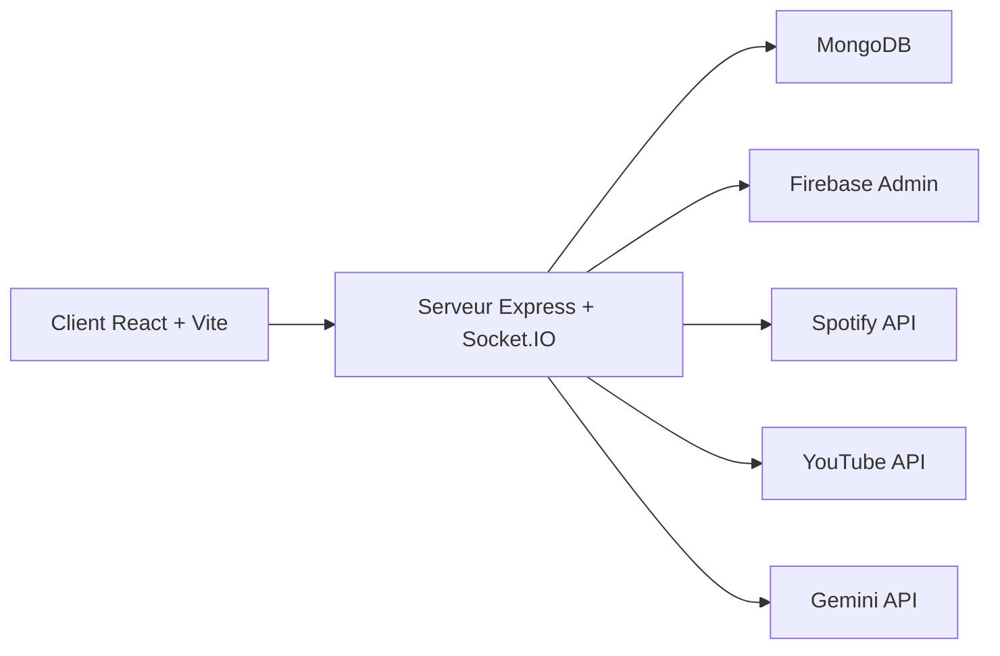

# yep-yogesh/Guessync

> Real-time multiplayer music guessing game with AI-generated hints, for friends and Node/React enthusiasts.

## The problem
There is no online blind-test game that relies on your own Spotify playlists and offers hints.

## What it actually does
Players create or join a room with a code. Tracks come from a Spotify playlist, audio is played via YouTube, answers go through Socket.IO with typo tolerance (Fuse.js), and a leaderboard is computed live. AI hints are generated (the README cites both OpenAI and Gemini, and the key listed is GEMINI_API_KEY). Firebase authentication, data in MongoDB.

## How it is wired


## Trying it
```bash
cp server/.env.example server/.env
cp client/.env.example client/.env
cd server && npm install
cd ../client && npm install
cd server && npm run dev
cd client && npm run dev
```

## Cost and gotchas
Many accounts to create: MongoDB, Firebase, Spotify, YouTube, plus Gemini or OpenAI for the hints. The Firebase private key must be in quotes with escaped line breaks. Last push in February 2026, 84 open issues.

## What it is not
Not a turnkey, deploy-ready product: the public Netlify/Render instance belongs to the author. The README is ambiguous about the AI hint provider (OpenAI or Gemini).

## Alternatives
No alternative named in the README.

## For you
Ignore: a demo game that requires five third-party services and brings nothing to data, AI or MLOps work, except as a Socket.IO example.
