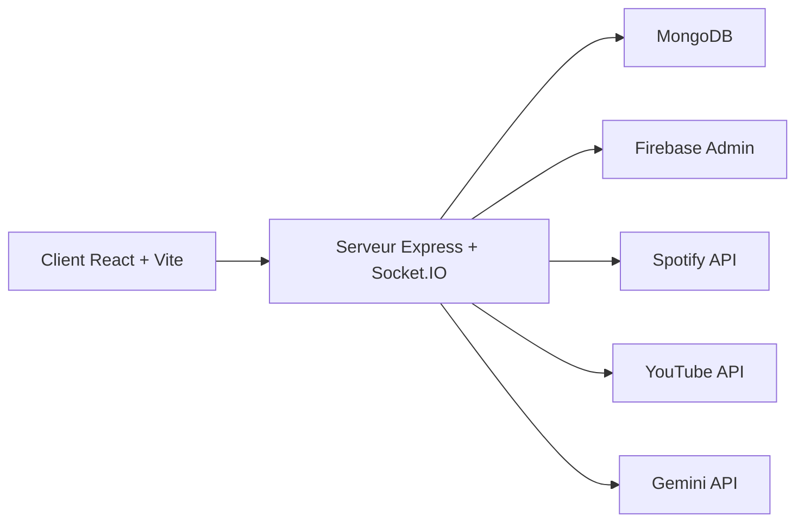

# yep-yogesh/Guessync

> Jeu multijoueur temps réel de devinettes musicales, avec indices générés par IA, pour amis et curieux de Node/React.

## Le problème
Il manque un jeu de blind test en ligne qui s'appuie sur ses propres playlists Spotify et propose des indices.

## Ce que ça fait vraiment
Les joueurs créent ou rejoignent une salle par code. Les morceaux viennent d'une playlist Spotify, l'audio est lu via YouTube, les réponses passent par Socket.IO avec tolérance aux fautes (Fuse.js), et un classement est calculé en direct. Des indices IA sont générés (le README cite à la fois OpenAI et Gemini, et la clé listée est GEMINI_API_KEY). Authentification Firebase, données dans MongoDB.

## Comment c'est branché


## Essayer
```bash
cp server/.env.example server/.env
cp client/.env.example client/.env
cd server && npm install
cd ../client && npm install
cd server && npm run dev
cd client && npm run dev
```

## Coût et pièges
Beaucoup de comptes à créer : MongoDB, Firebase, Spotify, YouTube, plus Gemini ou OpenAI pour les indices. La clé privée Firebase doit être entre guillemets avec retours à la ligne échappés. Dernier push en février 2026, 84 issues ouvertes.

## Ce que ce n'est pas
Pas un produit prêt à déployer clés en main : l'instance Netlify/Render publique appartient à l'auteur. Le README est ambigu sur le fournisseur d'indices IA (OpenAI ou Gemini).

## Alternatives
Aucune alternative nommée dans le README.

## Pour toi
À ignorer : jeu de démonstration qui exige cinq services tiers et n'apporte rien à un travail data, IA ou MLOps, sauf comme exemple Socket.IO.

