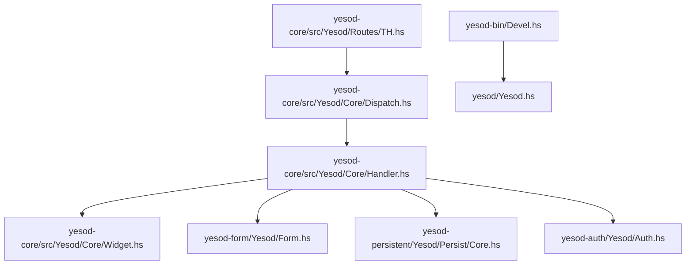

# yesodweb/yesod

> Strictly typed Haskell web framework, for developers who want routing errors caught at compile time.

## The problem
Dynamic web frameworks let broken routes, dead links and invalid templates slip through until runtime.

## What it actually does
yesod-core generates routing at compile time (Template Haskell), dispatching requests to handlers and widgets. Companion packages add forms, persistence, authentication and static files. yesod-bin is for development, yesod-test for testing.

## How it is wired


## Trying it
```bash
git clone --recurse-submodules http://github.com/yesodweb/yesod
stack build
```
The README points to the stack-based "quick start" guide for a first project.

## Cost and gotchas
Free. You need the Haskell toolchain (stack): the requirement is not in the prerequisites list, hence `aucun`. Real learning curve (Template Haskell, quasi-quotes).

## What it is not
Not a data science or AI tool. Not a framework you pick up in an hour if you do not know Haskell.

## Alternatives
No alternative named in the README.

## For you
Watch: interesting as technical culture, but unrelated to a Python-based data / AI / MLOps daily routine.
