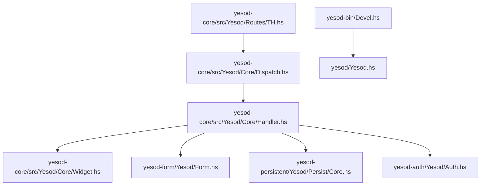

# yesodweb/yesod

> Framework web Haskell à typage strict, pour développeurs qui veulent des erreurs de routage détectées à la compilation.

## Le problème
Les frameworks web dynamiques laissent passer routes cassées, liens morts et gabarits invalides jusqu'à l'exécution.

## Ce que ça fait vraiment
yesod-core génère le routage à la compilation (Template Haskell), distribue les requêtes vers des handlers et des widgets. Des paquets compagnons ajoutent formulaires, persistance, authentification et fichiers statiques. yesod-bin sert au développement, yesod-test aux tests.

## Comment c'est branché


## Essayer
```bash
git clone --recurse-submodules http://github.com/yesodweb/yesod
stack build
```
Le README renvoie au guide « quick start » basé sur stack pour un premier projet.

## Coût et pièges
Gratuit. Il faut la chaîne Haskell (stack) : le besoin n'entre pas dans la liste des prérequis, d'où `aucun`. Courbe d'apprentissage réelle (Template Haskell, quasi-quotes).

## Ce que ce n'est pas
Pas un outil de data science ni d'IA. Pas un framework à prendre en main en une heure si on ne connaît pas Haskell.

## Alternatives
Aucune alternative nommée dans le README.

## Pour toi
Surveiller : intéressant en culture technique, mais sans lien avec un quotidien data / IA / MLOps basé sur Python.

