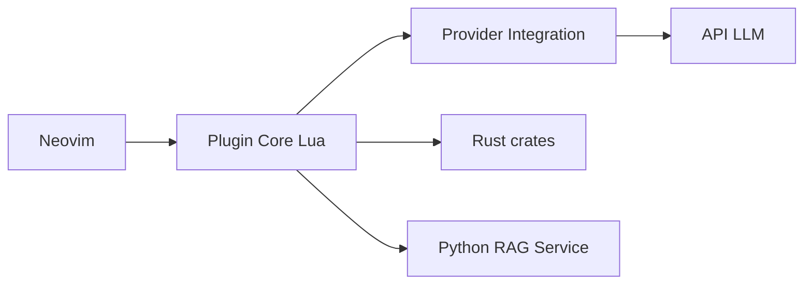

# yetone/avante.nvim

> Neovim plugin that brings Cursor-style AI assistance: chat with your code and apply the changes.

## The problem
Using an AI assistant in Neovim without leaving the editor or switching to a dedicated IDE.

## What it actually does
Sidebar and commands (`:AvanteAsk`, `:AvanteChat`); agentic mode with tools (file read/write, bash, git, web search); applying a diff with one command; `avante.md` for project instructions; many providers (Claude, OpenAI, Mistral, DeepSeek, Ollama, Copilot, ACP); optional RAG (Python service); Fast Apply via Morph. Rust crates for tokens, templates, repository map.

## How it is wired


## Trying it
```lua
{ "yetone/avante.nvim", build = "make", event = "VeryLazy", version = false, opts = { provider = "claude" } }
```
```sh
export AVANTE_ANTHROPIC_API_KEY=your-claude-api-key
```

## Cost and gotchas
Neovim 0.11+ required. LLM calls are billed to you; `cargo` needed to build. Tools are auto-approved by default (`auto_approve_tool_permissions = true`): the agent can run bash. Prompt log on disk enabled by default.

## What it is not
Not a reliable autonomous agent: the README talks about fast iterations and rough edges. Security is listed as needing improvement.

## Alternatives
mcphub.nvim (MCP), blink.cmp/nvim-cmp for completion; Aider and ChatGPT.nvim cited as sources of inspiration.

## For you
Relevant if you code in Neovim with LLMs: worth watching, with automatic tool approval turned off.
