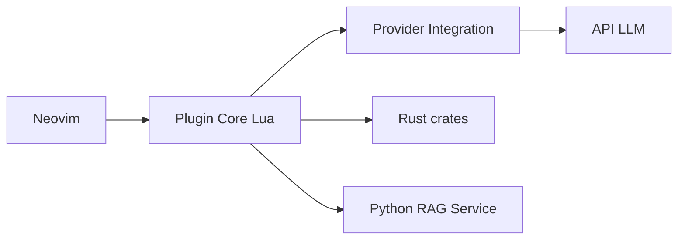

# yetone/avante.nvim

> Plugin Neovim qui apporte une assistance IA façon Cursor : discuter avec le code et appliquer les modifications.

## Le problème
Utiliser un assistant IA dans Neovim sans quitter l'éditeur ni passer à un IDE dédié.

## Ce que ça fait vraiment
Barre latérale et commandes (`:AvanteAsk`, `:AvanteChat`) ; mode agentique avec outils (lecture/écriture de fichiers, bash, git, recherche web) ; application d'un diff en une commande ; `avante.md` pour instructions de projet ; nombreux fournisseurs (Claude, OpenAI, Mistral, DeepSeek, Ollama, Copilot, ACP) ; RAG optionnel (service Python) ; Fast Apply via Morph. Crates Rust pour jetons, templates, plan du dépôt.

## Comment c'est branché


## Essayer
```lua
{ "yetone/avante.nvim", build = "make", event = "VeryLazy", version = false, opts = { provider = "claude" } }
```
```sh
export AVANTE_ANTHROPIC_API_KEY=your-claude-api-key
```

## Coût et pièges
Neovim 0.11+ requis. Facturation des appels LLM à ta charge ; `cargo` pour compiler. Outils auto-approuvés par défaut (`auto_approve_tool_permissions = true`) : l'agent peut exécuter bash. Journal de prompts sur disque activé par défaut.

## Ce que ce n'est pas
Pas un agent autonome fiable : le README parle d'itérations rapides et de bords rugueux. Sécurité listée comme à améliorer.

## Alternatives
mcphub.nvim (MCP), blink.cmp/nvim-cmp pour la complétion ; Aider et ChatGPT.nvim cités comme sources d'inspiration.

## Pour toi
Pertinent si tu codes sous Neovim avec des LLM : à surveiller, en désactivant l'approbation automatique des outils.

