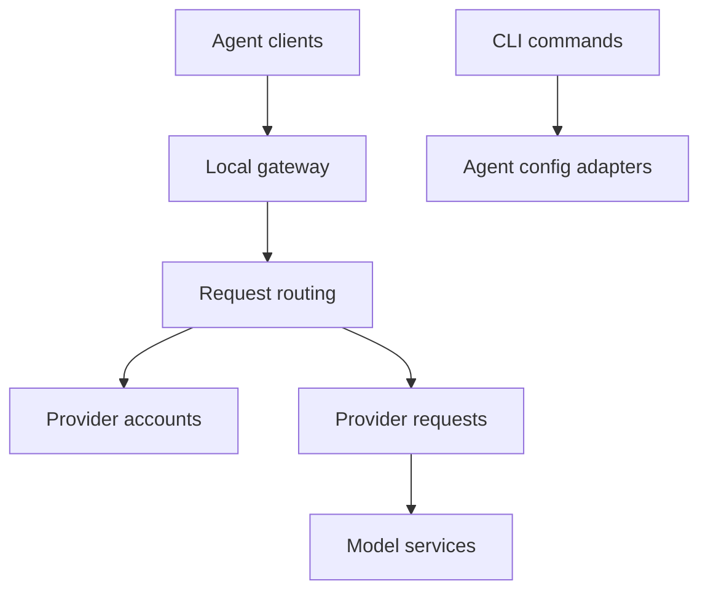

# yetone/magpie

> A local gateway that lets each coding agent use the model or subscription of your choice.

## The problem
Each agent (Claude Code, Codex, Gemini CLI) keeps its model, keys and format in its own file; a subscription only works in a single agent.

## What it actually does
A gateway on `127.0.0.1:3425` speaks OpenAI Chat, OpenAI Responses, Anthropic Messages and Gemini and translates between them. The app rewrites the agents' config to switch models, manages routing groups with quota failover, secret masking (off by default), and JavaScript plugins.

## How it is wired


## Trying it
```sh
curl -fsSL https://usemagpie.ai/install.sh | sh
magpie provider add deepseek sk-…
magpie claude deepseek/deepseek-v4-pro
magpie quota
```

## Cost and gotchas
Providers' keys or subscriptions remain at your expense. Daily telemetry is sent (random identifier, version, agents and providers used); it can be disabled in Settings → Privacy or with `DO_NOT_TRACK=1`.

## What it is not
Not a model provider. With a single account and no group, the quota error bubbles up to the agent. Masking hides the real value from the model.

## Alternatives
No alternative named in the README.

## For you
Worth watching: useful if you juggle several agents and subscriptions, but very recent, with 5,004 open issues.
