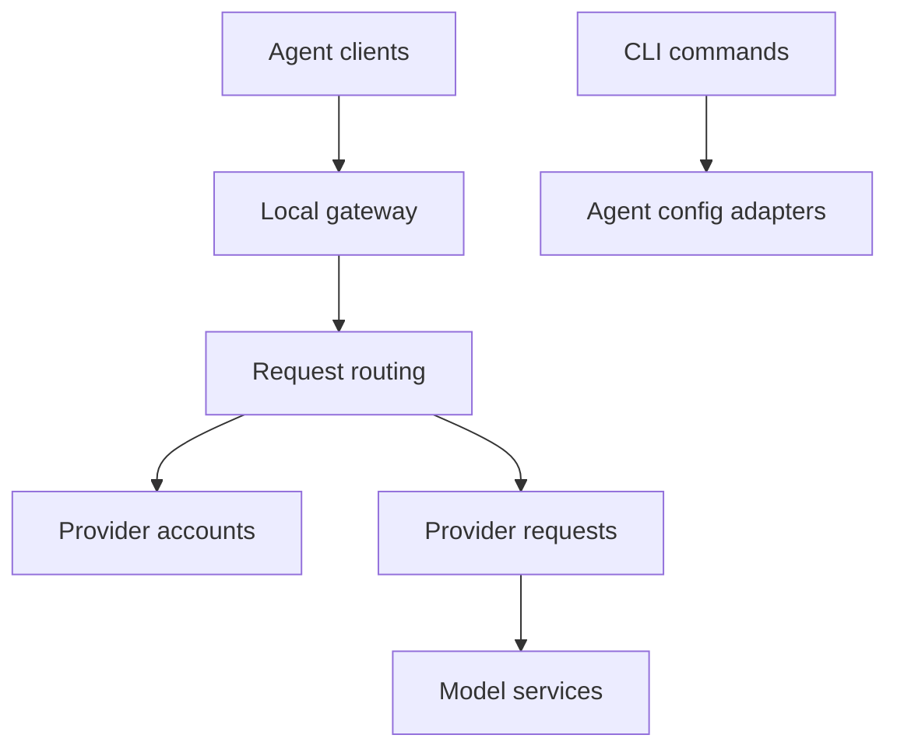

# yetone/magpie

> Passerelle locale qui laisse chaque agent de code utiliser le modèle ou l'abonnement de ton choix.

## Le problème
Chaque agent (Claude Code, Codex, Gemini CLI) garde son modèle, ses clés et son format dans son propre fichier ; un abonnement ne sert que dans un seul agent.

## Ce que ça fait vraiment
Une passerelle sur `127.0.0.1:3425` parle OpenAI Chat, OpenAI Responses, Anthropic Messages et Gemini et traduit entre eux. L'appli réécrit la config des agents pour changer de modèle, gère des groupes de routage avec bascule de quota, un masquage des secrets (désactivé par défaut), et des plugins en JavaScript.

## Comment c'est branché


## Essayer
```sh
curl -fsSL https://usemagpie.ai/install.sh | sh
magpie provider add deepseek sk-…
magpie claude deepseek/deepseek-v4-pro
magpie quota
```

## Coût et pièges
Les clés ou abonnements des fournisseurs restent à ta charge. Une télémétrie quotidienne est envoyée (identifiant aléatoire, version, agents et fournisseurs utilisés) ; désactivable dans Settings → Privacy ou avec `DO_NOT_TRACK=1`.

## Ce que ce n'est pas
Pas un fournisseur de modèles. Avec un seul compte et sans groupe, l'erreur de quota remonte à l'agent. Le masquage cache la valeur réelle au modèle.

## Alternatives
Aucune alternative nommée dans le README.

## Pour toi
À surveiller : utile si tu jongles entre plusieurs agents et abonnements, mais très récent, avec 5 004 issues ouvertes.

