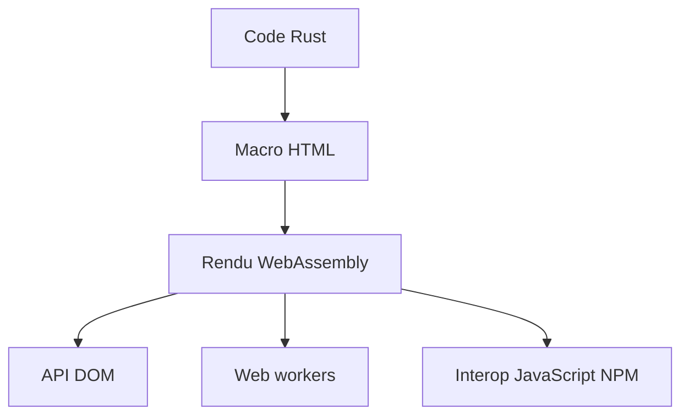

# yewstack/yew

> Rust framework compiled to WebAssembly for writing front-end web applications, for Rust developers.

## The problem
Writing an interactive web interface in Rust without going through JavaScript.

## What it actually does
A macro declares interactive HTML with Rust expressions, in a style close to JSX. The framework limits DOM API calls at each render and makes it easier to offload computation to web workers. It can talk to JavaScript and NPM packages.

## How it is wired
Simplified diagram based on the sheet, no diagram provided.

## Trying it
No command documented in the README, which points to the project documentation, Discord and the jetli/awesome-yew list.

## Cost and gotchas
Free. The Rust-to-Wasm build toolchain is not described in the README: not documented here. The README mostly asks for help on documentation and tests.

## What it is not
Not a data or AI tool. Not a JavaScript framework: you have to write in Rust. The README gives neither installation nor a code example.

## Alternatives
- jetli/awesome-yew: community list of resources around Yew and WebAssembly.

## For you
Ignore: a data / AI / MLOps profile rarely needs a Rust/Wasm front end; pick it up only for a lightweight dashboard written in Rust.
