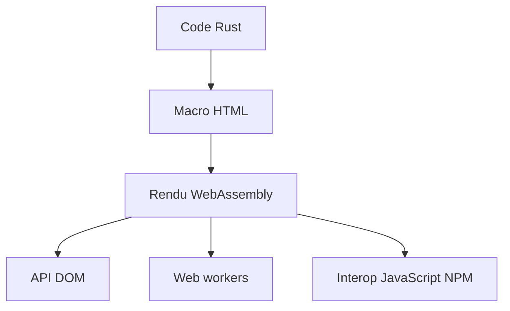

# yewstack/yew

> Framework Rust compilé en WebAssembly pour écrire des applications web front-end, pour développeurs Rust.

## Le problème
Écrire une interface web interactive en Rust sans passer par JavaScript.

## Ce que ça fait vraiment
Une macro déclare du HTML interactif avec des expressions Rust, dans un style proche de JSX. Le framework limite les appels à l'API DOM à chaque rendu et facilite le déport de calculs vers des web workers. Il sait dialoguer avec du JavaScript et des paquets NPM.

## Comment c'est branché
Schéma simplifié d'après la fiche, sans diagramme fourni.

## Essayer
Aucune commande documentée dans le README, qui renvoie à la documentation du projet, à Discord et à la liste jetli/awesome-yew.

## Coût et pièges
Gratuit. La chaîne de compilation Rust vers Wasm n'est pas décrite dans le README : non documenté ici. Le README demande surtout de l'aide sur la documentation et les tests.

## Ce que ce n'est pas
Ce n'est pas un outil de data ou d'IA. Ce n'est pas un framework JavaScript : il faut écrire en Rust. Le README ne donne ni installation ni exemple de code.

## Alternatives
- jetli/awesome-yew : liste communautaire de ressources autour de Yew et WebAssembly.

## Pour toi
À ignorer : un profil data / IA / MLOps a rarement besoin d'un front en Rust/Wasm ; à reprendre seulement pour un tableau de bord léger écrit en Rust.

