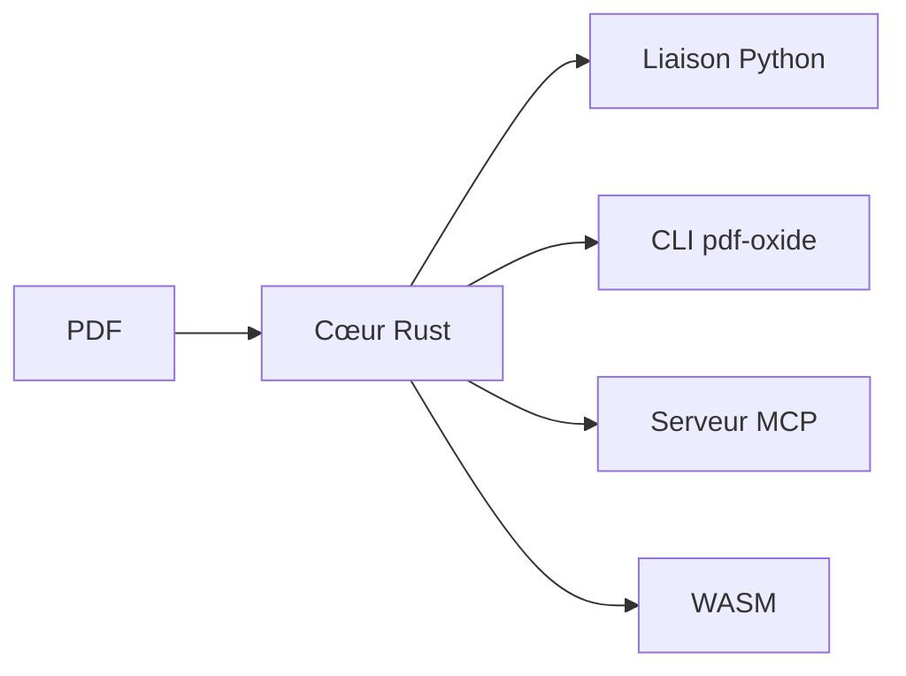

# yfedoseev/pdf_oxide

> Rust PDF library, with Python and other bindings, that extracts text and converts to Markdown.

## The problem
Extracting text from a PDF for a RAG pipeline is slow with common libraries, or requires an AGPL license (PyMuPDF).

## What it actually does
A Rust core that extracts text, characters, words, tables and images, converts to Markdown or HTML, fills forms and creates or edits PDFs. It ships with 19 language bindings (Python, Go, JS, Java, etc.), a 22-command CLI and a local MCP server. The README claims 0.8 ms per document and a 100% success rate on 3,830 PDFs; these figures are the author's.

## How it is wired
Simplified diagram based on the fiche, no diagram provided.


## Trying it
```bash
pip install pdf_oxide
pdf-oxide markdown document.pdf -o output.md
```

## Cost and gotchas
Free, local processing. Performance figures come from the author. Many open issues (228). The README states MIT while the catalog indicates Apache-2.0 ("MIT / Apache-2.0" elsewhere).

## What it is not
It is not an OCR: the benchmark excludes OCR. It is not a team project: the author is alone.

## Alternatives
PyMuPDF (slower, AGPL), pypdfium2 (Apache-2.0), pdfplumber, pypdf, pymupdf4llm, all cited by the README as competitors.

## For you
Worth a trial adoption for PDF ingestion in a RAG: a single `pip` command, local, no AGPL; validate the gain on your own documents.
