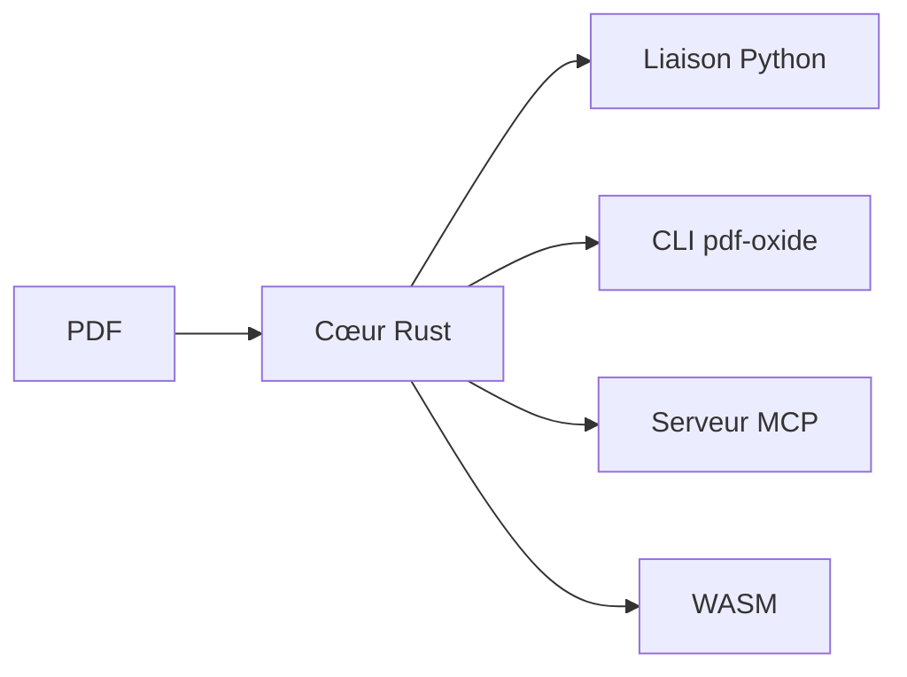

# yfedoseev/pdf_oxide

> Bibliothèque PDF en Rust, avec liaisons Python et autres, qui extrait le texte et convertit en Markdown.

## Le problème
Extraire le texte d'un PDF pour un pipeline RAG est lent avec les bibliothèques courantes, ou impose une licence AGPL (PyMuPDF).

## Ce que ça fait vraiment
Un cœur Rust qui extrait texte, caractères, mots, tables et images, convertit en Markdown ou HTML, remplit des formulaires et crée ou édite des PDF. Il est livré avec 19 liaisons de langages (Python, Go, JS, Java, etc.), un CLI de 22 commandes et un serveur MCP local. Le README annonce 0,8 ms par document et une réussite de 100 % sur 3 830 PDF ; ces chiffres sont ceux de l'auteur.

## Comment c'est branché
Schéma simplifié d'après la fiche, sans diagramme fourni.


## Essayer
```bash
pip install pdf_oxide
pdf-oxide markdown document.pdf -o output.md
```

## Coût et pièges
Gratuit, traitement local. Les performances viennent de l'auteur. Beaucoup d'issues ouvertes (228). Le README annonce MIT alors que le catalogue indique Apache-2.0 (« MIT / Apache-2.0 » ailleurs).

## Ce que ce n'est pas
Ce n'est pas un OCR : le benchmark exclut l'OCR. Ce n'est pas un projet d'équipe : l'auteur est seul.

## Alternatives
PyMuPDF (plus lent, AGPL), pypdfium2 (Apache-2.0), pdfplumber, pypdf, pymupdf4llm, tous cités par le README comme concurrents.

## Pour toi
À adopter à l'essai pour l'ingestion PDF d'un RAG : une seule commande `pip`, local, sans AGPL ; valide le gain sur tes propres documents.

