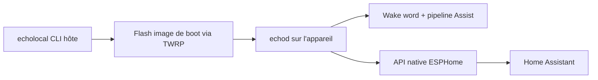

# ygelfand/echolocal

> Replaces the Amazon software on an Echo Dot or Echo Show with a local voice satellite for Home Assistant.

## The problem
Echo speakers depend on the Amazon cloud; the voice assistant and the displays cannot stay local in Home Assistant.

## What it actually does
Installs a Go service (`echod`) on the device that speaks the native ESPHome API: Home Assistant discovers it as an ESPHome device. It provides on-device wake words (microWakeWord, openWakeWord), a `media_player` speaker, intercom, timers, Bluetooth proxy, light sensor and updates. On Echo Show: dashboard, audio visuals, RTSP/ONVIF camera, Immich screensaver. An LED ring on the Dot. Five models listed (Dot 2, Show 5 ×2, Show 8 ×2).

## How it is wired


## Trying it
```bash
mv echolocal_linux_x86_64 echolocal
chmod +x echolocal
./echolocal install --name living-room
# depuis les sources :
make build-echod
make build-echod BOARD=crown
```

## Cost and gotchas
Free, but the device must be plugged in over USB with TWRP as recovery (XDA guides) and the installer flashes the boot image: risk of bricking the device. The README lists Fire OS 6.x/7.x only. Home Assistant required.

## What it is not
It is not an application installable on a stock Echo: the firmware has to be modified. The HACS integration is optional and adds a dashboard and a wake-word library.

## Alternatives
No alternative named in the README.

## For you
Keep an eye on it: use it only if you do local home automation on Home Assistant and accept flashing hardware; otherwise the data/AI interest is low.
