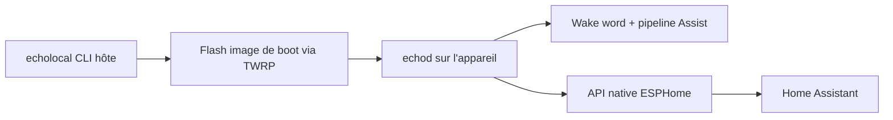

# ygelfand/echolocal

> Remplace le logiciel Amazon d'un Echo Dot ou Echo Show par un satellite vocal local pour Home Assistant.

## Le problème
Les enceintes Echo dépendent du cloud Amazon ; l'assistant vocal et les écrans ne peuvent pas rester locaux dans Home Assistant.

## Ce que ça fait vraiment
Installe sur l'appareil un service Go (`echod`) qui parle l'API native ESPHome : Home Assistant le découvre comme un appareil ESPHome. Il fournit mots de réveil sur l'appareil (microWakeWord, openWakeWord), haut-parleur `media_player`, intercom, minuteurs, proxy Bluetooth, capteur de lumière et mises à jour. Sur Echo Show : tableau de bord, visuels audio, caméra RTSP/ONVIF, économiseur Immich. Un anneau LED sur le Dot. Cinq modèles listés (Dot 2, Show 5 ×2, Show 8 ×2).

## Comment c'est branché


## Essayer
```bash
mv echolocal_linux_x86_64 echolocal
chmod +x echolocal
./echolocal install --name living-room
# depuis les sources :
make build-echod
make build-echod BOARD=crown
```

## Coût et pièges
Gratuit, mais l'appareil doit être branché en USB avec TWRP comme recovery (guides XDA) et l'installeur flashe l'image de boot : risque de bloquer l'appareil. Le README liste Fire OS 6.x/7.x uniquement. Home Assistant requis.

## Ce que ce n'est pas
Ce n'est pas une application installable sur un Echo stock : il faut modifier le firmware. L'intégration HACS est optionnelle et ajoute tableau de bord et bibliothèque de mots de réveil.

## Alternatives
Aucune alternative nommée dans le README.

## Pour toi
À surveiller : sers-toi-en uniquement si tu fais de la domotique locale sur Home Assistant et acceptes de flasher du matériel ; sinon l'intérêt data/IA est faible.

