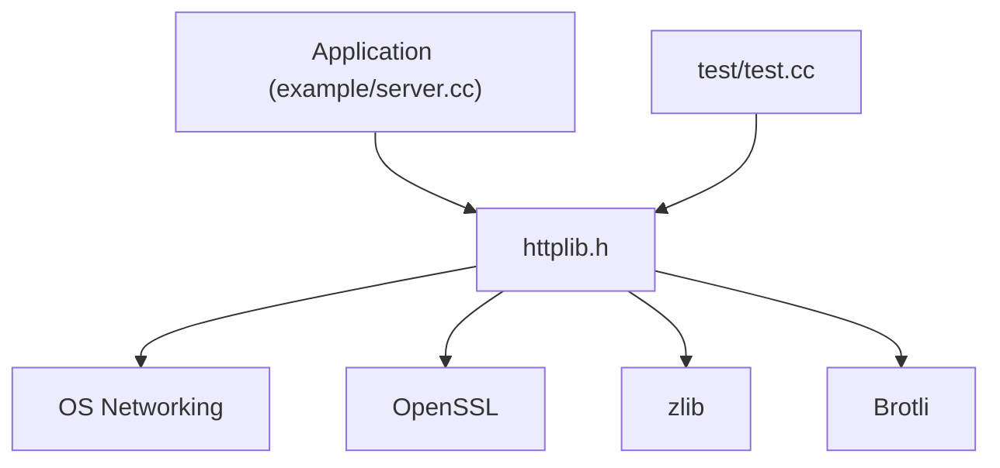

# yhirose/cpp-httplib

> Single-header C++11 library for an HTTP/HTTPS server and client, with blocking I/O.

## The problem
Embedding an HTTP server or client in C++ without a heavy dependency or a separate build.

## What it actually does
Including `httplib.h` is enough. Provides an HTTP/1.1 server and client, TLS (OpenSSL, MbedTLS, wolfSSL), a streaming API, Server-Sent Events, WebSocket, routing, static files, logging and error handlers. Blocking I/O; HTTP/2 and HTTP/3 are not implemented.

## How it is wired
Diagram based on the code's diagram, simplified.



## Trying it
```c++
#include "path/to/httplib.h"
httplib::Server svr;
svr.Get("/hi", [](const httplib::Request &, httplib::Response &res) {
  res.set_content("Hello World!", "text/plain");
});
svr.listen("0.0.0.0", 8080);
```

## Cost and gotchas
Free. 32-bit platforms are not supported (no security review). The README is truncated: the parts after the handlers are not read. A C++11 compiler is required.

## What it is not
Not asynchronous: the README says so. No HTTP/2. Not suited to heavy loads, judging by its own limits.

## Alternatives
None named in the README.

## For you
Ignore: low-level C++ library, far from your daily data / AI work; FastAPI or equivalent is enough.
