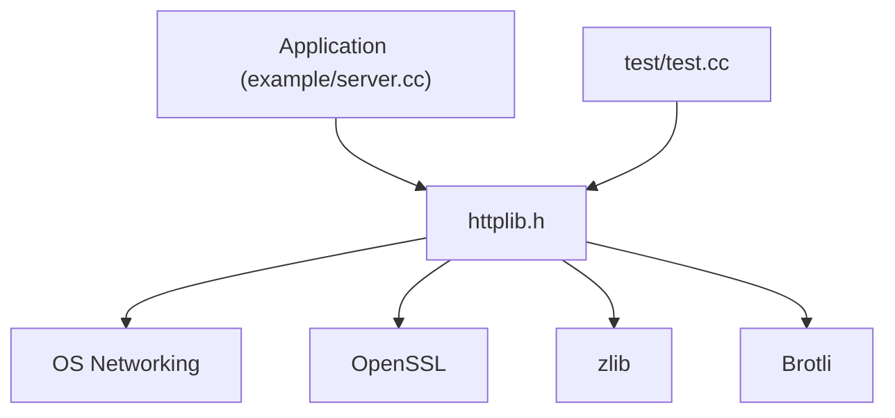

# yhirose/cpp-httplib

> Bibliothèque C++11 en un seul fichier d'en-tête pour serveur et client HTTP/HTTPS, à entrées-sorties bloquantes.

## Le problème
Embarquer un serveur ou un client HTTP en C++ sans lourde dépendance ni compilation séparée.

## Ce que ça fait vraiment
Inclure `httplib.h` suffit. Fournit serveur et client HTTP/1.1, TLS (OpenSSL, MbedTLS, wolfSSL), API de flux, Server-Sent Events, WebSocket, routage, fichiers statiques, journaux et gestionnaires d'erreurs. Entrées-sorties bloquantes ; HTTP/2 et HTTP/3 non implémentés.

## Comment c'est branché
Schéma d'après le diagramme du code, simplifié.



## Essayer
```c++
#include "path/to/httplib.h"
httplib::Server svr;
svr.Get("/hi", [](const httplib::Request &, httplib::Response &res) {
  res.set_content("Hello World!", "text/plain");
});
svr.listen("0.0.0.0", 8080);
```

## Coût et pièges
Gratuit. Plateformes 32 bits non prises en charge (aucune revue de sécurité). Le README est tronqué : les parties après les gestionnaires ne sont pas lues. Compilateur C++11 requis.

## Ce que ce n'est pas
Pas asynchrone : le README le dit. Pas de HTTP/2. Pas adapté aux fortes charges d'après ses propres limites.

## Alternatives
Aucune nommée dans le README.

## Pour toi
À ignorer : bibliothèque C++ de bas niveau, loin de ton quotidien data / IA ; FastAPI ou équivalent suffit.

