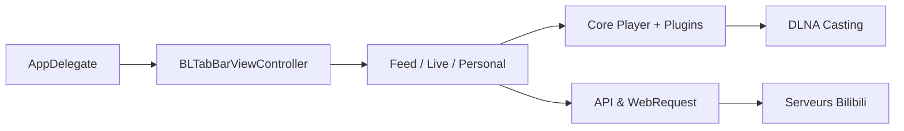

# yichengchen/ATV-Bilibili-demo

> Unofficial tvOS client for Bilibili, in demo, to watch videos and lives on Apple TV.

## The problem
Bilibili has no Apple TV app that covers these uses (danmaku, HDR, casting).

## What it actually does
QR code login, recommended feed, trending, rankings, search, history, live with comment bubbles (danmaku), HDR, subtitles and "Petit TV" casting. The architecture describes a plugin system for the player, a DLNA module and a request layer to Bilibili.

## How it is wired

## Trying it
The README gives no command. It points to an unsigned IPA in the repository's `nightly` release.

## Cost and gotchas
Free. The author states that no TestFlight or paid version exists: any paid offer is not authorized. It depends on Bilibili's unofficial API.

## What it is not
Not an app published on the App Store. Not an official Bilibili product. The README is in Chinese.

## Alternatives
No alternative named in the README.

## For you
Ignore: consumer video client, unrelated to your work.
