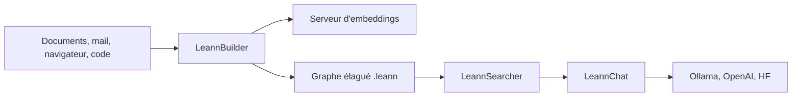

# yichuan-w/LEANN

> Local vector index that recomputes embeddings on demand to fit on a laptop.

## The problem
A classic vector index stores every embedding: millions of documents fill a laptop's disk.

## What it actually does
Stores a pruned graph (HNSW or DiskANN) and recomputes embeddings only for the visited nodes. The README claims 97% storage saved (60M chunks in 6 GB versus 201 GB). Builder, Searcher and Chat APIs, CLI (`build`, `search`, `ask`, `watch`), RAG applications (documents, mail, browser, iMessage, WeChat, ChatGPT, Claude) and an MCP server for Claude Code.

## How it is wired


## Trying it
```bash
uv venv
source .venv/bin/activate
uv pip install leann
leann build my-docs --docs ./your_documents
leann ask my-docs --interactive
```

## Cost and gotchas
Free locally (Ollama, HF models). OpenAI is the default LLM backend and requires `OPENAI_API_KEY`. Building DiskANN is heavy (MKL, boost, protobuf); several apps are macOS-only.

## What it is not
Recomputing embeddings costs compute on every query. The storage and recall figures come from the author. The README claims zero telemetry but links to an external survey.

## Alternatives
- FAISS: the classic vector database serving as the comparison baseline in the README.

## For you
Worth watching: interesting for frugal local RAG, but recomputation on every query and an undeclared license.
