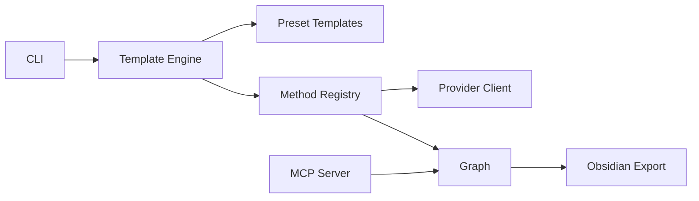

# yifanfeng97/Hyper-Extract

> Command-line tool that turns documents into structured knowledge graphs using YAML templates.

## The problem
Extracting entities and relations from a batch of documents means choosing a method, writing a schema and handling updates by hand.

## What it actually does
`he parse` reads a document (PDF, Word, HTML, EPUB…) with one of more than 80 YAML templates (finance, law, medicine, general) and produces a "knowledge abstraction": list, set, graph, hypergraph, temporal or spatial graph. More than 11 extraction methods are available (GraphRAG, LightRAG, KG-Gen…). You query with `he search`, visualize with `he show`, and export to Obsidian, GraphML, CSV, JSON-LD or Cypher. Each fact keeps its source: update, removal and audit per document. An MCP server (`he-mcp`) exposes search and export.

## How it is wired


## Trying it
```bash
uv tool install hyperextract
he config init -p openai -k YOUR_OPENAI_API_KEY
he parse examples/en/tesla.md -t general/biography_graph -o ./output/ -l en
he search ./output/ "What are Tesla's major achievements?"
he show ./output/
pip install 'hyperextract[mcp]'
```

## Cost and gotchas
Each extraction calls an LLM and an embeddings model; the README estimates DeepSeek at roughly $0.001 to $0.005 per page. A local deployment via vLLM is possible but requires a GPU. The README contains an AtomGit mirror sentence mentioning "Agent Reach", apparently unrelated: a sign of copy-paste. License not identified by GitHub.

## What it is not
It is not a service: everything runs locally, calling your providers. The README's comparison table (with GraphRAG, LightRAG, KG-Gen, ATOM) is the author's own, with no measurements. The displayed version is 0.10.3, before 1.0.

## Alternatives
- LightRAG: graph-based extraction and RAG method already integrated into the tool.
- GraphRAG: same, cited as an available method and as a comparison point.
- KG-Gen: graph extractor available in the tool.

## For you
Worth watching: handy for building a knowledge graph from reports, with source traceability; young (created in January 2026), single maintainer and license to be confirmed.
