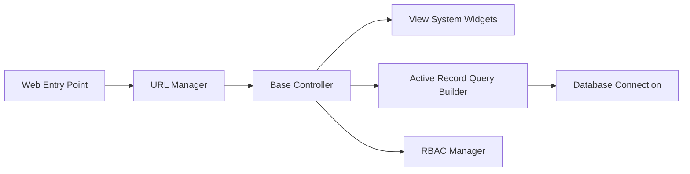

# yiisoft/yii2

> MVC PHP framework for web applications, with ActiveRecord, RBAC, caching and dependency injection.

## The problem
Build a structured PHP web app without reinventing routing, database access, caching and permissions.

## What it actually does
Web and console entry points, URL manager, controllers, views and widgets, asset bundles, ActiveRecord and query builder, components, events, dependency injection container and service locator, RBAC, file and memory caches.

## How it is wired

## Trying it
No command documented in the README: it points to the Definitive Guide.

## Cost and gotchas
Free. PHP 7.4 minimum, PHP 8 recommended. Security flaws are to be reported privately.

## What it is not
Not the current version of the line: Yii 2 is an older generation (see the site's release cycle).

## Alternatives
No alternative named in the README.

## For you
Ignore: a PHP framework outside your field.
