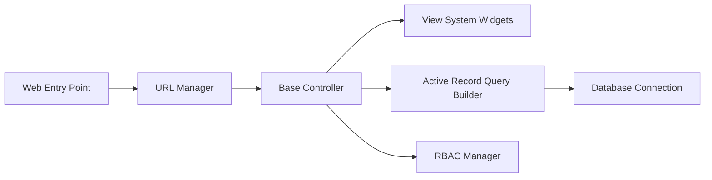

# yiisoft/yii2

> Framework PHP MVC pour applications web, avec ActiveRecord, RBAC, cache et injection de dépendances.

## Le problème
Bâtir une appli web PHP structurée sans réinventer routage, accès base, cache et droits.

## Ce que ça fait vraiment
Points d'entrée web et console, gestionnaire d'URL, contrôleurs, vues et widgets, bundles d'assets, ActiveRecord et constructeur de requêtes, composants, événements, conteneur d'injection et localisateur de services, RBAC, caches fichier et mémoire.

## Comment c'est branché

## Essayer
Aucune commande documentée dans le README : il renvoie au Definitive Guide.

## Coût et pièges
Gratuit. PHP 7.4 minimum, PHP 8 recommandé. Failles de sécurité à signaler en privé.

## Ce que ce n'est pas
Pas la version actuelle de la lignée : Yii 2 est une génération plus ancienne (voir cycle de publication du site).

## Alternatives
Aucune alternative nommée dans le README.

## Pour toi
Ignorer : framework PHP hors de ton domaine.

