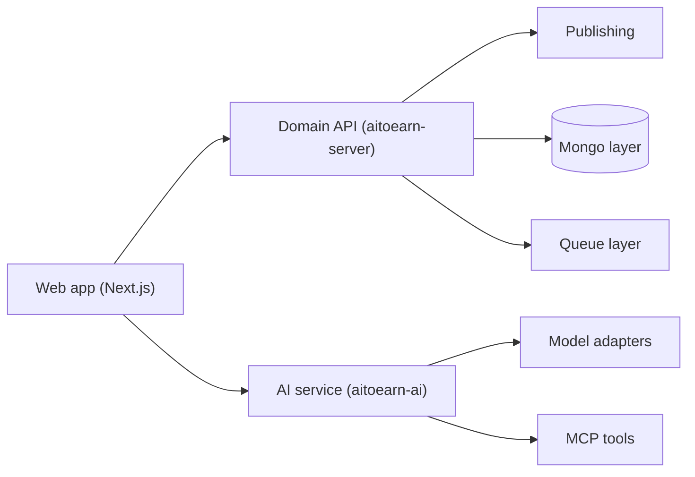

# yikart/AiToEarn

> A content marketing agent that generates, publishes and monetizes posts across about fifteen social networks.

## The problem
A creator or small organization publishes by hand on Douyin, TikTok, YouTube, X… and loses time producing, scheduling and replying.

## What it actually does
- Video and image generation by agent (Grok, Veo, Seedance, Nano Banana…), in batches.
- Scheduled multi-platform publishing, browser plugin for automatic likes and replies.
- Content marketplace with CPS, CPE or CPM settlement.
- Accessible through the website, OpenClaw, MCP (Claude, Cursor) or self-hosted.

## How it is wired


## Trying it
```bash
git clone https://github.com/yikart/AiToEarn.git
cd AiToEarn
docker compose up -d
# puis http://localhost:8080
```

## Cost and gotchas
API key obtained on aitoearn.cn or aitoearn.ai (the region must match, otherwise 401). To publish, you need a Relay to the official service or your own developer credentials per platform. Generation models billed per use.

## What it is not
Not fully autonomous: self-hosting relies on the official service for authorizations. README in Chinese, commercial sponsorship displayed. Automatic likes and replies carry a risk with respect to platform rules (not addressed in the README).

## Alternatives
The README lists MoneyPrinterTurbo and NarratoAI (video generation) as "Recommended", without comparison.

## For you
Ignore: a social marketing tool outside your core business, with dependency on the original SaaS; only the MCP server example may serve as inspiration.
