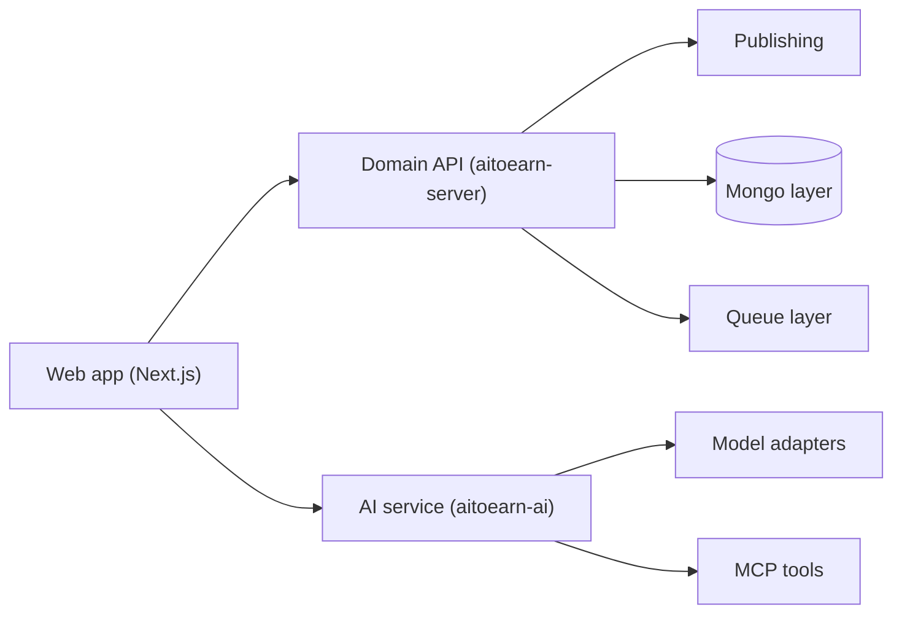

# yikart/AiToEarn

> Agent de marketing de contenu qui génère, publie et fait monétiser des posts sur une quinzaine de réseaux sociaux.

## Le problème
Un créateur ou une petite structure publie à la main sur Douyin, TikTok, YouTube, X… et perd du temps à produire, planifier et répondre.

## Ce que ça fait vraiment
- Génération de vidéos et d'images par agent (Grok, Veo, Seedance, Nano Banana…), en lot.
- Publication planifiée multi-plateformes, plugin navigateur pour likes et réponses automatiques.
- Place de marché de contenu avec règlement CPS, CPE ou CPM.
- Accessible par le site, OpenClaw, MCP (Claude, Cursor) ou en auto-hébergement.

## Comment c'est branché


## Essayer
```bash
git clone https://github.com/yikart/AiToEarn.git
cd AiToEarn
docker compose up -d
# puis http://localhost:8080
```

## Coût et pièges
Clé d'API obtenue sur aitoearn.cn ou aitoearn.ai (région à faire correspondre, sinon 401). Pour publier, il faut un Relay vers le service officiel ou ses propres identifiants développeur par plateforme. Modèles de génération facturés à l'usage.

## Ce que ce n'est pas
Pas entièrement autonome : l'auto-hébergement s'appuie sur le service officiel pour les autorisations. README en chinois, parrainage commercial affiché. Les likes et réponses automatiques posent un risque vis-à-vis des règles des plateformes (non traité dans le README).

## Alternatives
Le README cite en « Recommandé » MoneyPrinterTurbo et NarratoAI (génération vidéo), sans comparaison.

## Pour toi
À ignorer : outil de marketing social hors de ton cœur de métier, avec dépendance au SaaS d'origine ; seul l'exemple de serveur MCP peut servir d'inspiration.

