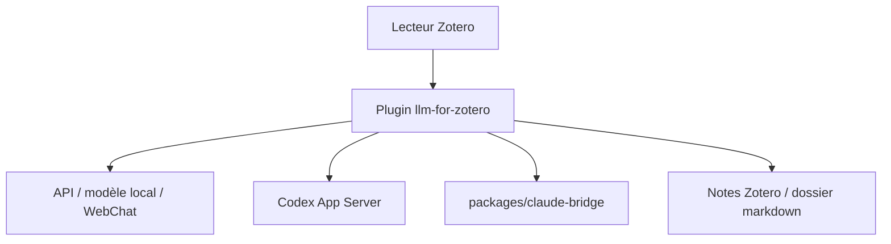

# yilewang/llm-for-zotero

> Zotero extension that adds an LLM assistant to the PDF reader, for researchers.

## The problem
Reading, summarizing and comparing papers forces you to copy text between Zotero and an external chat, with no citation back to the source.

## What it actually does
In the Zotero reader: questions about the current PDF, selected text, figures and attached files, with citations that point back to the passage. Notes saved in Zotero or as markdown (Obsidian, Logseq). A beta Agent mode reads, searches, tags and edits the library, with confirmation and undo. Backends: API keys, local models, WebChat, Codex App Server and Claude Code. The supplied README is truncated in the Claude Code section.

## How it is wired
Simplified diagram based on the sheet, no diagram provided.


## Trying it
```bash
npm install -g @openai/codex
codex login
claude
```
Then install the `.xpi` file from Releases in Zotero: `Tools` -> `Add-ons` -> `Install Add-on From File`.

## Cost and gotchas
Free, but the model provider is paid: API key, or a ChatGPT Plus or Claude subscription. Tavily web search consumes credits, DeepSeek charges $0.75 per 1,000 calls. Web requests go to the chosen provider.

## What it is not
Not an offline tool by default: the text of the papers is sent to the chosen model. Agent mode is disabled by default and in beta. The Codex and Claude Code modes are mutually exclusive.

## Alternatives
No alternative named in the README.

## For you
Worth watching: relevant for scientific monitoring in Zotero, but in beta, under AGPL and dependent on a paid model.
