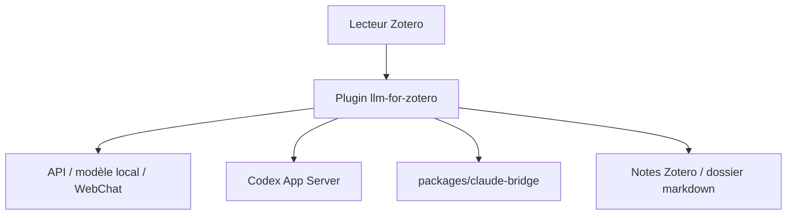

# yilewang/llm-for-zotero

> Extension Zotero qui ajoute un assistant LLM au lecteur de PDF, pour chercheurs.

## Le problème
Lire, résumer et comparer des articles oblige à copier du texte entre Zotero et un chat externe, sans citation vers la source.

## Ce que ça fait vraiment
Dans le lecteur Zotero : questions sur le PDF courant, texte sélectionné, figures et fichiers joints, avec citations qui renvoient au passage. Notes enregistrées dans Zotero ou en markdown (Obsidian, Logseq). Un mode Agent bêta lit, cherche, étiquette et modifie la bibliothèque, avec confirmation et annulation. Backends : clés d'API, modèles locaux, WebChat, Codex App Server et Claude Code. Le README fourni est tronqué dans la section Claude Code.

## Comment c'est branché
Schéma simplifié d'après la fiche, sans diagramme fourni.


## Essayer
```bash
npm install -g @openai/codex
codex login
claude
```
Installer ensuite le fichier `.xpi` des Releases dans Zotero : `Tools` -> `Add-ons` -> `Install Add-on From File`.

## Coût et pièges
Gratuit, mais le fournisseur de modèle est payant : clé d'API, ou abonnement ChatGPT Plus ou Claude. La recherche web Tavily consomme des crédits, DeepSeek facture 0,75 $ les 1 000 appels. Les requêtes web partent chez le fournisseur choisi.

## Ce que ce n'est pas
Pas un outil hors ligne par défaut : le texte des articles part vers le modèle choisi. Le mode Agent est désactivé par défaut et en bêta. Les modes Codex et Claude Code s'excluent l'un l'autre.

## Alternatives
Aucune alternative nommée dans le README.

## Pour toi
À surveiller : pertinent pour une veille scientifique dans Zotero, mais en bêta, sous AGPL et dépendant d'un modèle payant.

