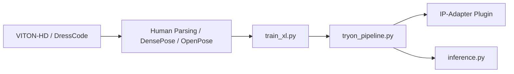

# yisol/IDM-VTON

> Official implementation of a diffusion model for virtual garment try-on, for vision researchers.

## The problem
Diffusion-based virtual try-ons often distort garments and lose details.

## What it actually does
Code from the paper: training and inference on VITON-HD and DressCode, with a modified SDXL pipeline (adapted UNet and attention) and IP-Adapter. Preprocessing with human parsing, DensePose and OpenPose. A local Gradio demo exists, which shows DensePose according to the code.

## How it is wired


## Trying it
```bash
git clone https://github.com/yisol/IDM-VTON.git
cd IDM-VTON
conda env create -f environment.yaml
conda activate idm
accelerate launch inference.py --width 768 --height 1024 --num_inference_steps 30 --output_dir "result" --unpaired --data_dir "DATA_DIR" --seed 42 --test_batch_size 2 --guidance_scale 2.0
```

## Cost and gotchas
Beefy GPU (training with batch size 6, 8-bit Adam). Manual download of datasets and checkpoints. License not identified by GitHub; last push in March 2025.

## What it is not
Not a product: a research repository with no API or packaging. The README does not specify usage rights for the weights.

## Alternatives
The README names no alternative.

## For you
Ignore unless you have a virtual try-on project: unclear license, little activity, heavy setup.
