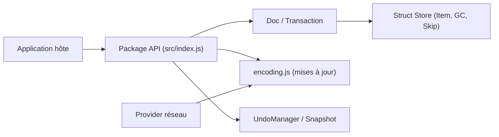

# yjs/yjs

> CRDT library that exposes shared types merged without conflict, for collaborative applications.

## The problem
Synchronizing simultaneous editing of a document between several people, offline included, without a central conflict-resolution server.

## What it actually does
Provides shared types (`Y.Array`, `Y.Map`, `Y.Text`, `Y.XmlFragment`…) whose modifications produce binary updates that can be exchanged and merged in any order. Network-independent: transport (y-websocket, y-webrtc, Hocuspocus…), persistence (y-indexeddb…) and editor bindings (ProseMirror, Quill, Monaco…) are separate modules. Handles undo/redo, snapshots, shared cursors and two update formats.

## How it is wired


## Trying it
```sh
npm i yjs y-websocket
PORT=1234 node ./node_modules/y-websocket/bin/server.cjs
```

## Cost and gotchas
Free; professional support available through a sponsorship contract. The README warns that text CRDTs only grow (not all tombstones can be purged). A license is present but not identified by GitHub: to be checked.

## What it is not
It is not a server or a database: you need a provider for networking and persistence.

## Alternatives
- Automerge: compared in the crdt-benchmarks cited by the README.

## For you
Watch: relevant for collaborative notebooks or editors (JupyterLab uses it, according to the README); license to be clarified.
