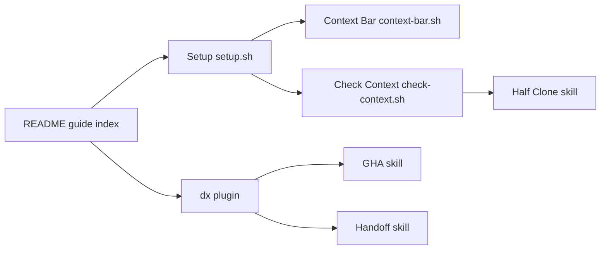

# ykdojo/claude-code-tips

> A guide of 45+ Claude Code tips, with scripts and a "dx" skills plugin.

## The problem
Claude Code has many features (skills, hooks, worktrees, remote control) that are hard to discover; you lose time with a saturated context and manual approvals.

## What it actually does
The README is the product: tips on the statusline, manual compaction through HANDOFF.md, worktrees, containers, TDD, auto mode.
Shell scripts: `context-bar.sh` (status bar), `check-context.sh` (a hook that triggers a half-clone at 85%), conversation cloning.
`dx` plugin: skills `/dx:gha` (CI failure analysis), `/dx:handoff`, `/dx:half-clone`, `reddit-fetch`, `review-claudemd`...
An interactive install script that modifies `settings.json` and the shell.

## How it is wired


## Trying it
```bash
claude plugin marketplace add ykdojo/claude-code-tips
claude plugin install dx@ykdojo
```

## Cost and gotchas
Assumes a Claude subscription or key. The setup script disables auto-updates and attribution by default; review each item. License not identified.

## What it is not
Not official documentation: personal opinions, some depending on specific Claude Code versions. Not a library.

## Alternatives
- Playwright MCP: recommended as a companion for browser automation.

## For you
Worth watching: the handoff/half-clone patterns and `/gha` transfer directly to your daily Claude Code use; pick from them rather than installing everything at once.
