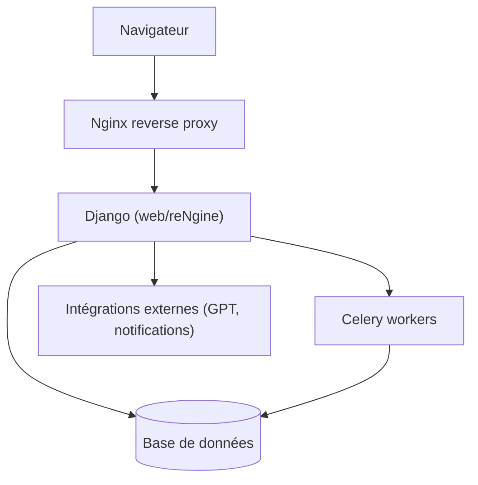

# yogeshojha/rengine

> Web suite for reconnaissance and vulnerability scanning, for pentesters and bug bounty hunters.

## The problem
Reconnaissance of a target produces scattered JSON, text and CSV files that are hard to correlate.

## What it actually does
Django application with Celery tasks that chains open source tools: subdomains, ports, endpoints, fuzzing, screenshots, Nuclei, WHOIS, WAF. YAML scan engines, subscans, projects, roles, PDF reports, Slack, Discord and Telegram alerts. GPT features (reports, attack surface) or local LLMs are optional.

## How it is wired


## Trying it
```bash
git clone https://github.com/yogeshojha/rengine && cd rengine
nano .env
sudo ./install.sh
sudo ./update.sh
```

## Cost and gotchas
Change `POSTGRES_PASSWORD` in `.env`. Celery concurrency depends on RAM (4 GB: 10, 8 GB: 30, 16 GB: 50). GPT features require an OpenAI key.

## What it is not
Not a data/AI tool: it is an offensive security tool. Use it only on authorized targets.

## Alternatives
No alternative named in the README.

## For you
Ignore: pentest tool outside your data/AI/MLOps profile, unless you are auditing your own attack surface.
