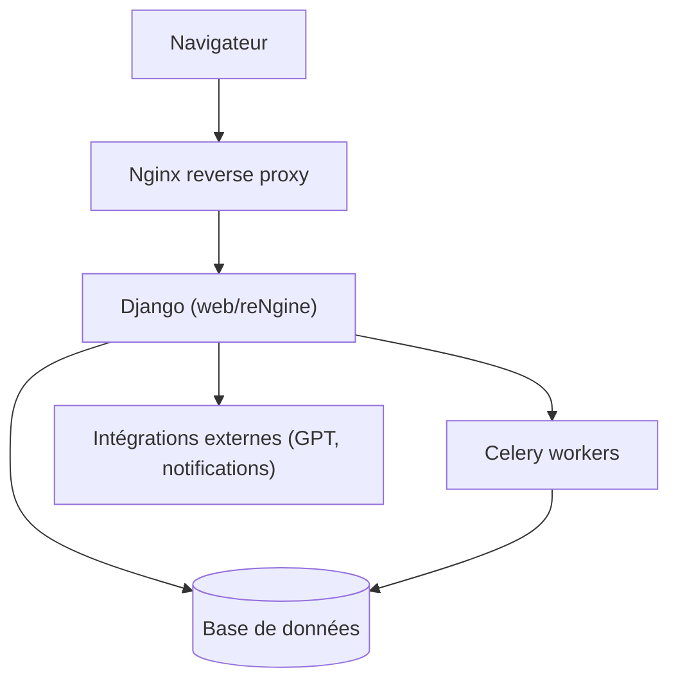

# yogeshojha/rengine

> Suite web de reconnaissance et de scan de vulnérabilités pour pentesters et chasseurs de primes.

## Le problème
La reconnaissance d'une cible produit des fichiers JSON, texte et CSV dispersés, difficiles à corréler.

## Ce que ça fait vraiment
Application Django avec tâches Celery qui enchaîne des outils open source : sous-domaines, ports, endpoints, fuzzing, captures d'écran, Nuclei, WHOIS, WAF. Moteurs de scan en YAML, sous-scans, projets, rôles, rapports PDF, alertes Slack, Discord, Telegram. Des fonctions GPT (rapports, surface d'attaque) ou LLM locaux sont optionnelles.

## Comment c'est branché


## Essayer
```bash
git clone https://github.com/yogeshojha/rengine && cd rengine
nano .env
sudo ./install.sh
sudo ./update.sh
```

## Coût et pièges
Changer `POSTGRES_PASSWORD` dans `.env`. Concurrence Celery selon la RAM (4 Go : 10, 8 Go : 30, 16 Go : 50). Les fonctions GPT demandent une clé OpenAI.

## Ce que ce n'est pas
Pas un outil data/IA : c'est un outil offensif de sécurité. À n'utiliser que sur des cibles autorisées.

## Alternatives
Aucune alternative nommée dans le README.

## Pour toi
Ignorer : outil de pentest hors de ton profil data/IA/MLOps, sauf si tu audites ta propre surface d'attaque.

