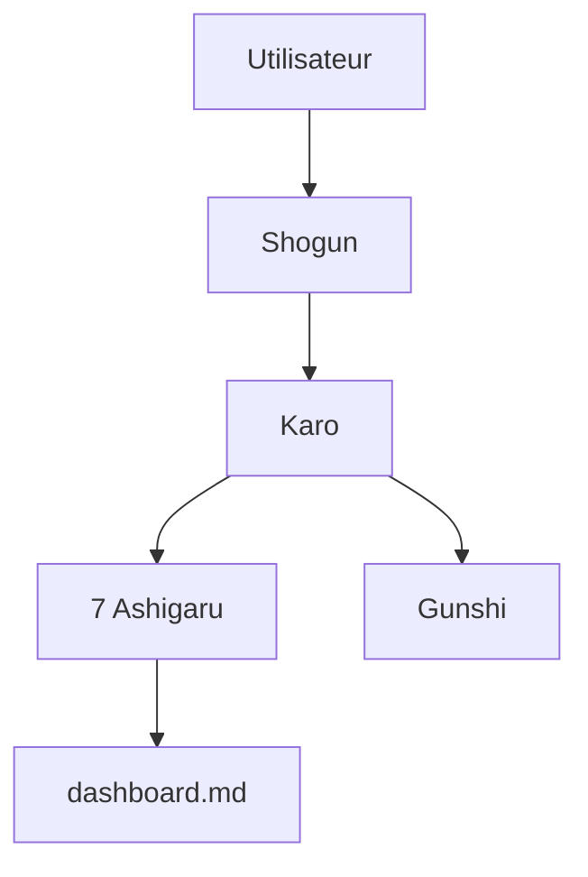

# yohey-w/multi-agent-shogun

> Scripts that orchestrate up to ten coding agents in parallel via tmux, with a samurai hierarchy.

## The problem
Coordinating several coding agents costs tokens in exchanges and makes tracking opaque.

## What it actually does
A Shogun receives the order, a Karo splits it up, seven Ashigaru work and a Gunshi analyzes. The agents exchange YAML files, woken by inotify or tmux. Tracking in `dashboard.md`, cross-session memory via Memory MCP, an Android control app. The README is truncated before the end.

## How it is wired


## Trying it
```bash
git clone https://github.com/yohey-w/multi-agent-shogun
cd multi-agent-shogun
bash first_setup.sh
claude --dangerously-skip-permissions
bash shutsujin_departure.sh
```

## Cost and gotchas
Subscriptions or keys for each CLI (Claude Code, Codex, etc.). The README touts a cost on the order of $200 per month on a flat plan versus more than $100 per hour via API. The first launch requires `--dangerously-skip-permissions`. WSL2 on Windows.

## What it is not
Not a framework: shell scripts and YAML files. No fixed-cost guarantee, which depends on the providers' terms. The author himself reduced his army to a single agent (successor project kagemusha).

## Alternatives
The README compares it to Claude Code `Task` and Agent Teams, LangGraph and CrewAI.

## For you
Keep an eye on it: a readable, low-cost file-based coordination idea, but the author has himself moved beyond it; keep it as a reference, not as a tool.
