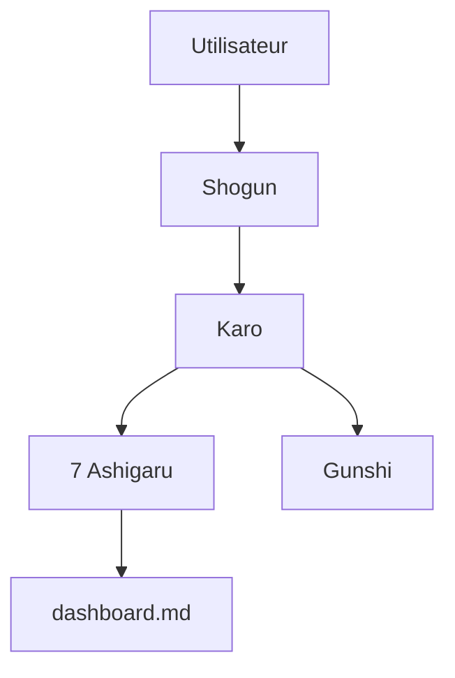

# yohey-w/multi-agent-shogun

> Scripts qui orchestrent jusqu'à dix agents de code en parallèle via tmux, avec une hiérarchie samouraï.

## Le problème
Coordonner plusieurs agents de code coûte des jetons en échanges et rend le suivi opaque.

## Ce que ça fait vraiment
Un Shogun reçoit l'ordre, un Karo le découpe, sept Ashigaru travaillent et un Gunshi analyse. Les agents s'échangent des fichiers YAML, réveillés par inotify ou tmux. Suivi dans `dashboard.md`, mémoire inter-sessions via Memory MCP, application Android de pilotage. Le README est tronqué avant la fin.

## Comment c'est branché


## Essayer
```bash
git clone https://github.com/yohey-w/multi-agent-shogun
cd multi-agent-shogun
bash first_setup.sh
claude --dangerously-skip-permissions
bash shutsujin_departure.sh
```

## Coût et pièges
Abonnements ou clés pour chaque CLI (Claude Code, Codex, etc.). Le README vante un coût de l'ordre de 200 $ par mois en forfait contre plus de 100 $ par heure en API. Le premier lancement demande `--dangerously-skip-permissions`. WSL2 sous Windows.

## Ce que ce n'est pas
Pas un framework : des scripts shell et des fichiers YAML. Pas de garantie de coût fixe, qui dépend des conditions des fournisseurs. L'auteur a lui-même réduit son armée à un seul agent (projet successeur kagemusha).

## Alternatives
Le README compare à Claude Code `Task` et Agent Teams, LangGraph et CrewAI.

## Pour toi
À surveiller : idée de coordination par fichiers lisible et peu coûteuse, mais l'auteur l'a lui-même dépassée ; garde-la comme référence, pas comme outil.

