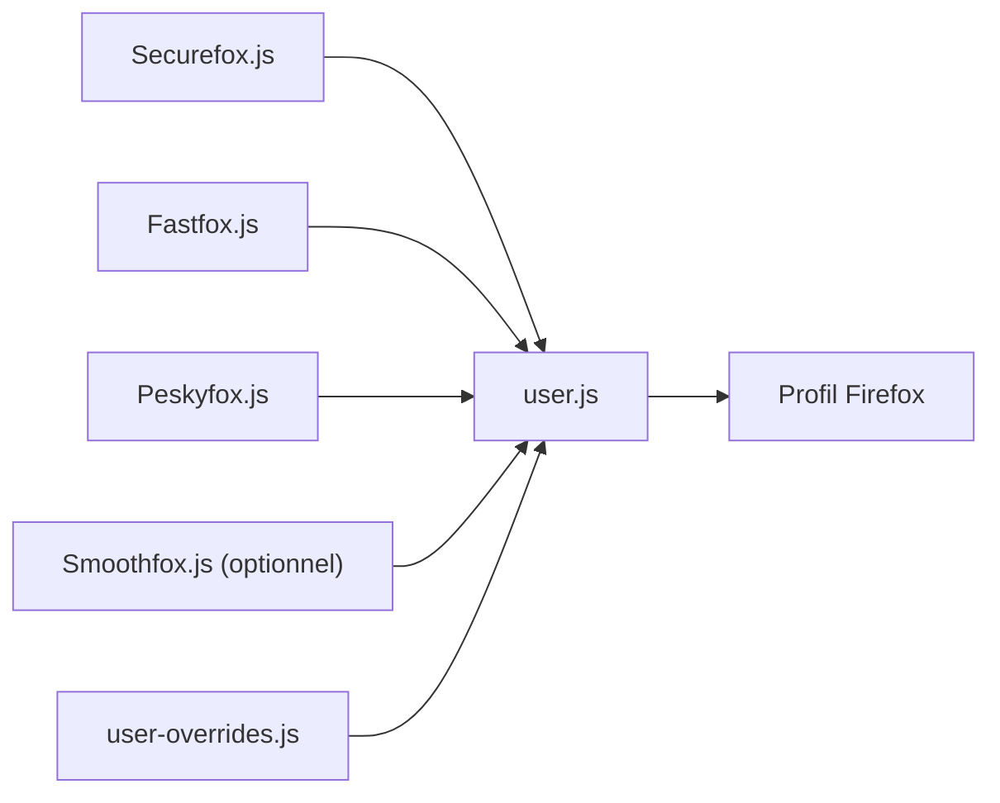

# yokoffing/Betterfox

> user.js file of about:config settings to make Firefox more private and smoother, for advanced users.

## The problem
Firefox's default settings leave telemetry, distractions and conservative performance parameters in place, and tuning them one by one in about:config is time-consuming.

## What it actually does
Provides a `user.js` built from themed guides: Securefox (privacy), Fastfox (performance), Peskyfox (browsing comfort) and Smoothfox (scrolling, optional). The file is copied into the Firefox profile and applied on restart; an `install.py` exists for advanced users and a `user-overrides.js` allows personal overrides. Variants exist for Waterfox and Zen.

## How it is wired


## Trying it
```bash
about:profiles
```
Open the profile root folder, drop `user.js` in it, restart Firefox (README steps; make a backup profile first).

## Cost and gotchas
Free. Some settings can break websites: reread "Common Overrides" and "Optional Hardening". The README warns about fake sites claiming to be Betterfox.

## What it is not
Not a browser nor an extension; and the README notes that forks that bundle it often modify it, reducing its effect.

## Alternatives
- arkenfox (cited in credits): the base Betterfox builds on, stricter.
- Firefox-UI-Fix and Narsil/desktop_user.js (cited in the guides).

## For you
Worth watching: a comfort gain with no direct link to your job; test it on a throwaway profile before adopting.
