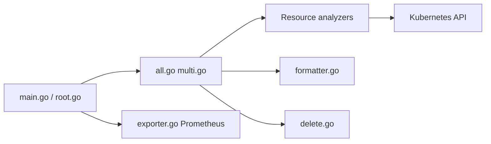

# yonahd/kor

> Command-line tool that finds unused Kubernetes resources in a cluster, for operators.

## The problem
Clusters accumulate orphaned ConfigMaps, Secrets, PVCs and Services, hard to spot by hand.

## What it actually does
Subcommands per resource type (ConfigMaps, Secrets, Services, PVCs, Ingresses, Roles, CRDs, Pods, Jobs, etc.) and `all`. Table, JSON or YAML output, grouping by namespace or resource, `--show-reason` option. Interactive or non-interactive deletion, `kor/used=true|false` labels, Prometheus exporter, Slack notification, Helm deployment as a cronjob.

## How it is wired


## Trying it
```bash
brew install kor
kor all -n test --show-reason
kor configmap --include-namespaces my-namespace --delete
```

## Cost and gotchas
Free; kubeconfig access to the cluster. `--delete --no-interactive` deletes without asking. A cloud offering (KorPro) exists for cost analysis.

## What it is not
Not a cost tool nor multi-cluster: that falls to KorPro, which is paid. It detects "unused" heuristically, to be reviewed before deletion.

## Alternatives
No alternative named in the README (KorPro is the same author's cloud offering).

## For you
Adopt to audit a cluster before cleaning up: MIT, several install methods, active; keep `--delete` in interactive mode.
