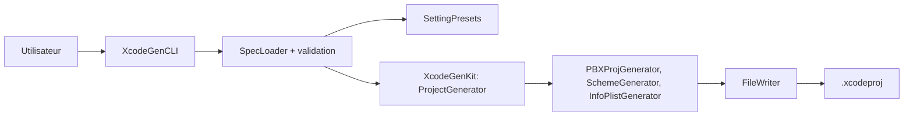

# yonaskolb/XcodeGen

> Swift command-line tool that generates an Xcode project from a YAML or JSON specification file.

## The problem
`.xcodeproj` files cause merge conflicts and drift out of sync with the folders on disk.

## What it actually does
Reads `project.yml` (targets, configurations, schemes, settings, Carthage dependencies, SDKs, Swift packages) and generates the Xcode project, mirroring the directory tree. Specs can be split across several files. Setting groups are shareable, a cache (`--use-cache`) avoids regenerating, and `xcodegen dump` prints the resolved spec. The core is split into the modules `ProjectSpec`, `XcodeGenCLI`, `XcodeGenCore` and `XcodeGenKit`.

## How it is wired


## Trying it
```bash
brew install xcodegen
mint install yonaskolb/xcodegen
xcodegen generate
```

## Cost and gotchas
Free. A stable (non-beta) version of Xcode must be installed. 404 open issues.

## What it is not
It is not a build system: it produces the Xcode project, and compilation is still done by Xcode.

## Alternatives
Tuist, Xcake and struct are named by the README as options if XcodeGen does not fit.

## For you
Ignore: only useful to those developing Apple apps; nothing for a data/AI/MLOps profile.
