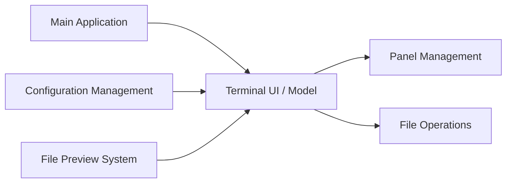

# yorukot/superfile

> Terminal file manager (TUI) in Go, with panels, themes and previews.

## The problem
Navigating and manipulating files on the command line with `ls`, `cp` and `mv` is tedious.

## What it actually does
A panel-based terminal interface, keyboard shortcuts (vim variant available), themes, plugins, file preview (images, PDF), compression and extraction. Automatic update check at most once every 24 h, can be disabled with `auto_check_update`. The detailed README points to the wiki for the tutorial, hotkeys and themes.

## How it is wired


## Trying it
```bash
bash -c "$(curl -sLo- https://superfile.dev/install.sh)"
winget install --id yorukot.superfile
spf
```

## Cost and gotchas
Free. The install script is downloaded and run in one line: the README invites you to inspect it. The update check contacts GitHub.

## What it is not
It is not a synchronization tool or a graphical explorer.

## Alternatives
No alternative named in the README.

## For you
Keep an eye on it: a useful comfort for browsing datasets on a server, without being indispensable.
