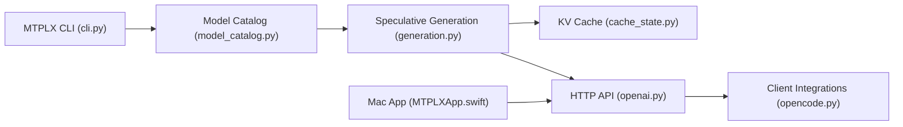

# youssofal/MTPLX

> Mac app and CLI that speed up local LLMs using the model's multi-token prediction heads.

## The problem
Local LLMs on Apple Silicon decode slowly, and speed tricks often change the output distribution.

## What it actually does
The model proposes several tokens, a batched pass verifies them, and exact rejection sampling validates them: the distribution remains that of the model. Gains measured by the author: 1.6x on a Mac mini M4 16 GB, 2.24x on M5 Max. It serves an OpenAI- and Anthropic-compatible API locally, plus embeddings and reranking, with automatic depth tuning, an MTP model forge and a dashboard.

## How it is wired


## Trying it
```bash
brew install youssofal/mtplx/mtplx
mtplx start
mtplx serve --model Youssofal/Qwen3.8-Flash-Next-MTPLX-Optimized-Speed
mtplx tune --retune
```

## Cost and gotchas
Apple Silicon and macOS 14+. The largest model weighs 115 GB (about 83 GB resident) and requires a Mac with 96 GB or more; the 27B fits from 32 GB. Fan control requires a sudo password.

## What it is not
Not a CUDA project: MLX and Apple Silicon only (vLLM for Linux). The speeds are measured by the author.

## Alternatives
- llama.cpp, Ollama, LM Studio, mlx-lm: compared by the author at mtplx.com/compare.

## For you
Worth watching: interesting if you run LLMs on a Mac, otherwise irrelevant; the exactness of the sampling is the real argument.
