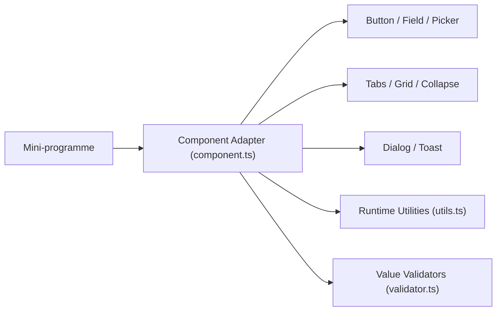

# youzan/vant-weapp

> UI component library for WeChat mini-programs, aimed at Chinese front-end developers.

## The problem
Building a WeChat mini-program interface by hand means rewriting buttons, forms, pickers and dialogs in the format imposed by the platform.

## What it actually does
Provides WeChat custom components (Button, Field, Picker, Calendar, Cascader, Uploader, Tabs, Dialog, Toast…) to be declared in `usingComponents` and then used in WXML. A common layer handles component adaptation, utilities, validation and relations between components. Minimum base: mini-program library 2.6.5. README in Chinese only.

## How it is wired


## Trying it
```bash
npm i @vant/weapp -S --production
npm install
npm run dev
```

## Cost and gotchas
Free (MIT). Requires the WeChat developer tools and a mini-program; the published example is not up to date because of WeChat review.

## What it is not
Not a general-purpose web library: it only runs within the WeChat mini-program ecosystem. The Vue 2/3 versions are separate projects.

## Alternatives
- Vue version of Vant (cited in the README): for a mobile web application rather than a mini-program.
- React version and Alipay version maintained by the community (cited in the README).

## For you
Ignore for a data/AI/MLOps profile: it is WeChat mini-program UI, unrelated to data or model deployment.
