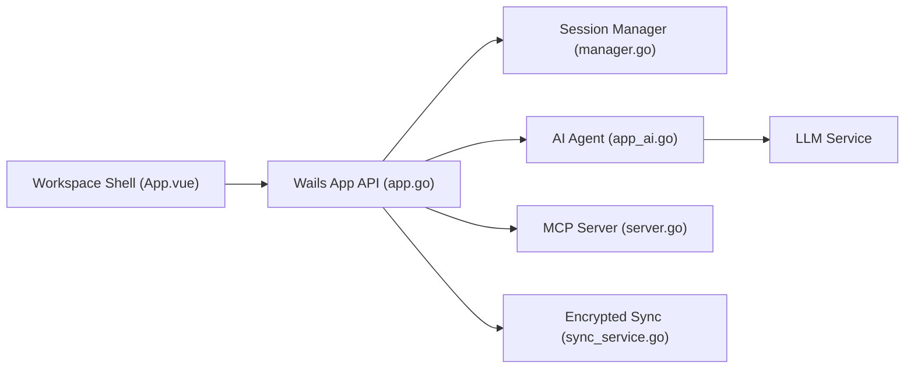

# ys-ll/uniterm

> All-in-one terminal for remote access (SSH, SFTP, databases, Kubernetes) with an AI agent and an MCP server.

## The problem
Remote access is scattered across a terminal, an SFTP client, a database client and container tools.

## What it actually does
Wails/Go desktop application with Vue: SSH/Telnet/serial, file transfer, remote desktop, database clients, Docker/Kubernetes, server monitoring. An AI agent plans and runs commands in the active terminal (Anthropic API or OpenAI-compatible), with control modes. An MCP server lets external agents use the saved connections. Sync through a private Git repository or WebDAV.

## How it is wired


## Trying it
```bash
brew install --cask ys-ll/uniterm/uniterm
scoop bucket add uniterm https://github.com/ys-ll/scoop-uniterm && scoop install uniterm
git clone https://github.com/ys-ll/uniterm.git
cd frontend && npm install && cd ..
wails3 build
```

## Cost and gotchas
LLM provider and key are at your expense for the agent. Unsigned executable: antivirus false positives possible. The build requires wails3 v3.0.0-beta.27.

## What it is not
Not a safe agent by default: choose the approval mode. The Wails v3 framework is in beta.

## Alternatives
No alternative named in the README.

## For you
Worth watching: the agent and the MCP server are of interest to an MLOps profile that administers servers, but the project is five months old.
