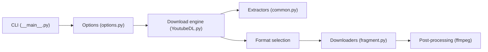

# yt-dlp/yt-dlp

> Online audio and video download tool, command-line based, for thousands of websites, and also usable as a Python module.

## The problem
Obtaining a video or audio stream, with the correct format, subtitles, and metadata, varies from site to site and quickly becomes impossible once the site changes.

## What it actually does
Starting from a URL, the tool extracts metadata and the list of formats, chooses a format based on a selector (`-f`) or sorting (`-S`), downloads (with resuming and parallel fragments), and then performs post-processing using ffmpeg: audio extraction, subtitles, thumbnails, chapters, and SponsorBlock. It integrates with Python (`YoutubeDL`) and manages plugins, configuration via files, and browser cookies.

## How it is wired


## Trying it
```bash
yt-dlp -U
yt-dlp --update-to nightly
python -m pip install -U --pre "yt-dlp[default]"
yt-dlp -F URL
yt-dlp -t mp3 URL
```

## Cost and gotchas
Free. It is highly recommended to use ffmpeg and ffprobe, as well as a JavaScript runtime (deno is recommended, or node, bun, QuickJS) for full YouTube support. The PyInstaller binaries contain code under GPLv3+: the entire package is therefore under GPLv3+ (the repository itself is under Unlicense). The `stable` channel is often outdated; the README recommends using the `nightly` version.

## What it is not
No guaranteed workaround: websites change and break extractors. Plugins are not controlled, and the README advises against using them unless you trust the code.

## Alternatives
- youtube-dl: yt-dlp is a fork of this project; it should only be used with Python 2.6+ or 3.2+, as yt-dlp does not support these versions.

## For you
To be adopted: subtitles, audio, and metadata in a single command-line interface, which is very useful for creating a video/audio corpus before transcription or analysis.
