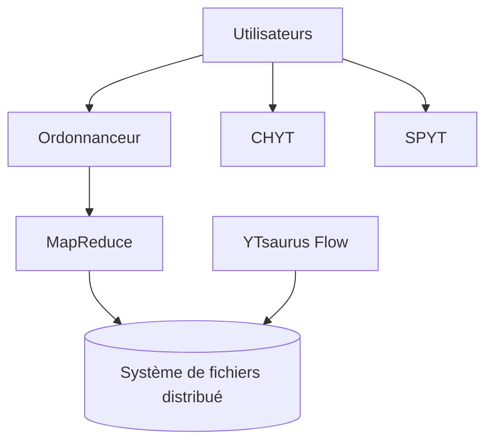

# ytsaurus/ytsaurus

> Distributed platform for storing and processing massive data, with MapReduce and a key-value database.

## The problem
Data teams stack separate systems for storage, batch computing, SQL and real time, which are hard to share between users.

## What it actually does
A multi-tenant ecosystem: MapReduce, distributed file system, NoSQL key-value database with ACID transactions, scheduler. On top come YTsaurus Flow (real-time streams with exactly-once processing), CHYT (SQL on ClickHouse) and SPYT (Spark). The README claims scales of several thousand nodes.

## How it is wired
Simplified diagram based on the fiche, no diagram provided.

## Trying it
Not documented as a command in the README: try a cluster on Kubernetes or the online demo, or build from source.

## Cost and gotchas
Free, but a real cluster demands significant infrastructure and expertise; Kubernetes is the route indicated. The tracker has 519 open issues.

## What it is not
Not a tool for a laptop or a small dataset. Not a simple SQL engine: CHYT and SPYT are separate layers.

## Alternatives
The README cites ClickHouse and Apache Spark as the bases of CHYT and SPYT, without comparing them.

## For you
To watch: an open alternative to a large-scale Hadoop and Spark stack, relevant only if you operate large volumes.
