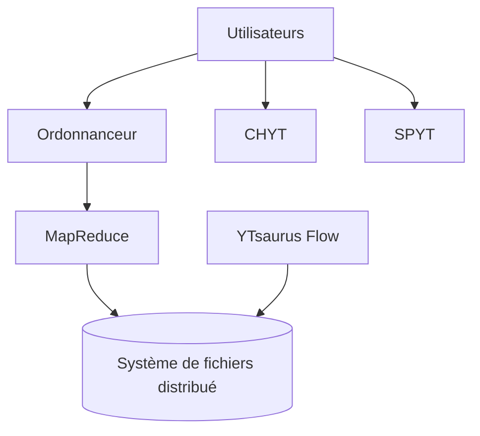

# ytsaurus/ytsaurus

> Plateforme distribuée de stockage et de traitement de données massives, avec MapReduce et base clé-valeur.

## Le problème
Les équipes data empilent des systèmes séparés pour le stockage, le calcul par lots, le SQL et le temps réel, difficiles à partager entre utilisateurs.

## Ce que ça fait vraiment
Un écosystème multi-locataire : MapReduce, système de fichiers distribué, base NoSQL clé-valeur avec transactions ACID, ordonnanceur. S'y ajoutent YTsaurus Flow (flux temps réel avec traitement exactement une fois), CHYT (SQL sur ClickHouse) et SPYT (Spark). Le README annonce des échelles de plusieurs milliers de nœuds.

## Comment c'est branché
Schéma simplifié d'après la fiche, sans diagramme fourni.

## Essayer
Non documenté en commande dans le README : essayer un cluster sur Kubernetes ou la démonstration en ligne, ou compiler depuis les sources.

## Coût et pièges
Gratuit, mais un vrai cluster demande une infrastructure et une expertise importantes ; Kubernetes est la voie indiquée. Le suivi compte 519 tickets ouverts.

## Ce que ce n'est pas
Pas un outil pour un portable ou un petit jeu de données. Pas un simple moteur SQL : CHYT et SPYT sont des couches séparées.

## Alternatives
Le README cite ClickHouse et Apache Spark comme bases de CHYT et SPYT, sans les comparer.

## Pour toi
À surveiller : alternative ouverte à une pile Hadoop et Spark à grande échelle, pertinente seulement si tu opères de gros volumes.

