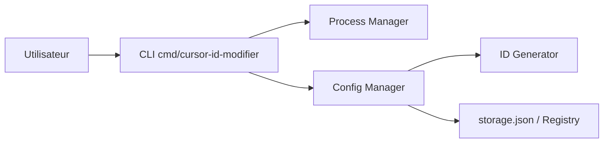

# yuaotian/go-cursor-help

> Script that resets Cursor's machine identifiers to get around the free trial limit.

## The problem
Users of the Cursor editor hit the free trial limit; the tool claims to reset it.

## What it actually does
Regenerates the telemetry identifiers (`machineId`, `devDeviceId`, `sqmId`…) in Cursor's `storage.json`, kills the Cursor process and, on Windows, modifies the `MachineGuid` registry key (with a backup). Installed through `curl | sudo bash` or `irm | iex`. The README also contains commercial offers for "Codex" access and Claude API access, and crypto donation addresses.

## How it is wired


## Trying it
```bash
curl -fsSL https://raw.githubusercontent.com/yuaotian/go-cursor-help/refs/heads/master/scripts/run/cursor_linux_id_modifier.sh | sudo bash
```
(Command from the README, do not run without reading the script first.)

## Cost and gotchas
Remote script executed as root, Windows registry modification: real system risk. Circumvents a third-party service's terms; account potentially blocked.

## What it is not
Not a development tool; a workaround trick, accompanied by commercial advertising in the README.

## Alternatives
No alternative named in the README.

## For you
Ignore: security risk (root script), circumvention of terms of use, single maintainer with a commercial agenda.
