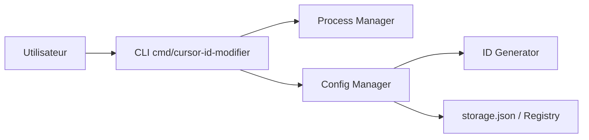

# yuaotian/go-cursor-help

> Script qui réinitialise les identifiants machine de Cursor pour contourner la limite d'essai gratuit.

## Le problème
Les utilisateurs de l'éditeur Cursor atteignent la limite de l'essai gratuit ; l'outil prétend la relancer.

## Ce que ça fait vraiment
Régénère les identifiants de télémétrie (`machineId`, `devDeviceId`, `sqmId`…) dans le `storage.json` de Cursor, tue le processus Cursor et, sous Windows, modifie la clé de registre `MachineGuid` (avec sauvegarde). Installation par `curl | sudo bash` ou `irm | iex`. Le README contient aussi des offres commerciales d'accès « Codex » et d'API Claude, et des adresses de dons en crypto.

## Comment c'est branché


## Essayer
```bash
curl -fsSL https://raw.githubusercontent.com/yuaotian/go-cursor-help/refs/heads/master/scripts/run/cursor_linux_id_modifier.sh | sudo bash
```
(Commande du README, à ne pas lancer sans relire le script.)

## Coût et pièges
Exécution de script distant en root, modification du registre Windows : risque système réel. Contourne les conditions d'un service tiers ; compte potentiellement bloqué.

## Ce que ce n'est pas
Pas un outil de développement ; une astuce de contournement, assortie de publicité commerciale dans le README.

## Alternatives
Aucune alternative nommée dans le README.

## Pour toi
À ignorer : risque de sécurité (script en root), contournement de conditions d'utilisation, mainteneur unique avec démarche commerciale.

