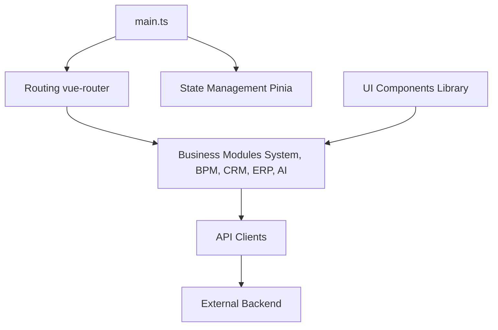

# yudaocode/yudao-ui-admin-vue3

> Vue 3 and Element Plus admin interface of the Yudao foundation, for Chinese enterprise application developers.

## The problem
Building a complete back office (permissions, workflow, payment, CRM, ERP) takes months of repetitive development.

## What it actually does
Provides the front end of an admin foundation with user, role, menu, tenant and log management, code generation, workflow (BPMN and simple designers), payment, reports and business modules (mall, ERP, CRM, IoT, AI). It consumes a separate Spring Boot or Spring Cloud back end. README in Chinese, with demos hosted by the author.

## How it is wired


## Trying it
```bash
# macOS / Linux
VITE_USE_BUNDLE_ANALYZER=true pnpm build:prod
```
The README requires Node above 16.18.0 and pnpm above 8.6.0 (pnpm mandatory). The detailed startup command points to external documentation.

## Cost and gotchas
Free, the author states there will be no commercial version. Useless without the matching Java back end. Stack frozen on Vue 3.3 and Vite 4 according to the table.

## What it is not
Not a standalone product: it is only the interface. Not data-science oriented, despite the "AI" module on the back-end side.

## Alternatives
The README mentions the Vue2 + element-ui version and a Vue3 + vben (ant-design-vue) version of the same project.

## For you
Ignore: Java/China back-office foundation unrelated to a data / AI / MLOps profile.
