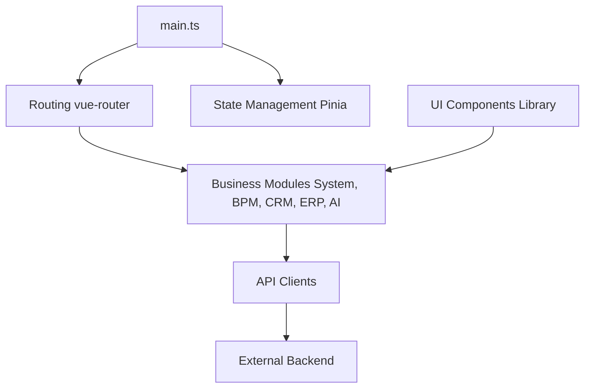

# yudaocode/yudao-ui-admin-vue3

> Interface d'administration Vue 3 et Element Plus du socle Yudao, pour développeurs d'applications d'entreprise chinoises.

## Le problème
Construire un back-office complet (droits, workflow, paiement, CRM, ERP) demande des mois de développement répétitif.

## Ce que ça fait vraiment
Fournit le front d'un socle d'administration avec gestion des utilisateurs, rôles, menus, locataires, journaux, génération de code, workflow (designers BPMN et simple), paiement, rapports et modules métier (mall, ERP, CRM, IoT, AI). Il consomme un back-end Spring Boot ou Spring Cloud séparé. README en chinois, avec des démos hébergées par l'auteur.

## Comment c'est branché


## Essayer
```bash
# macOS / Linux
VITE_USE_BUNDLE_ANALYZER=true pnpm build:prod
```
Le README exige Node supérieur à 16.18.0 et pnpm supérieur à 8.6.0 (pnpm obligatoire). La commande de démarrage détaillée renvoie à une documentation externe.

## Coût et pièges
Gratuit, l'auteur affirme qu'il n'y aura pas de version commerciale. Inutile sans le back-end Java correspondant. Stack figée sur Vue 3.3 et Vite 4 d'après le tableau.

## Ce que ce n'est pas
Pas un produit autonome : c'est seulement l'interface. Pas orienté data science, malgré le module « AI » côté back-end.

## Alternatives
Le README cite la version Vue2 + element-ui et une version Vue3 + vben (ant-design-vue) du même projet.

## Pour toi
À ignorer : socle de back-office Java/Chine sans rapport avec un profil data / IA / MLOps.

