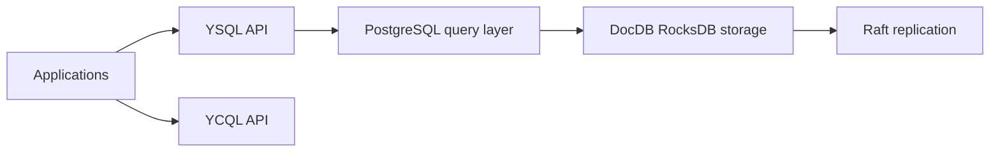

# yugabyte/yugabyte-db

> Distributed PostgreSQL-compatible SQL database for cloud-native OLTP applications requiring strong consistency.

## The problem
A single PostgreSQL database neither scales out nor easily survives the loss of a zone or a region.

## What it actually does
Reuses the PostgreSQL query layer (YSQL) and offers a Cassandra-like API (YCQL). Distributed storage, Raft replication, Spanner-inspired ACID transactions, snapshot/serializable/read committed isolation levels, xCluster, CDC, read replicas. The README claims an RPO of 0 and an RTO of 3 seconds for a single-region deployment.

## How it is wired


## Trying it
```bash
# Le README renvoie au Quick Start externe ; aucune commande n'y figure.
```

## Cost and gotchas
Open source Apache 2.0 per the README, but the license appears as "unidentified" in the catalog. Several nodes recommended; hosted options (Aeon, Anywhere) are separate. 8,660 open issues.

## What it is not
Not full PostgreSQL compatibility: features are enabled version by version. Not an analytical warehouse: it targets OLTP.

## Alternatives
No alternative named in the README.

## For you
Worth watching: relevant for distributed transactional databases beneath your AI services, with a license check and operating cost to weigh.
