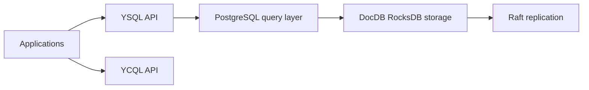

# yugabyte/yugabyte-db

> Base SQL distribuée compatible PostgreSQL pour applications OLTP cloud-natives à forte cohérence.

## Le problème
Une base PostgreSQL unique ne monte pas en charge ni ne survit aisément à la perte d'une zone ou d'une région.

## Ce que ça fait vraiment
Réutilise la couche de requêtes PostgreSQL (YSQL) et propose une API type Cassandra (YCQL). Stockage distribué, réplication Raft, transactions ACID inspirées de Spanner, niveaux d'isolation snapshot/serializable/read committed, xCluster, CDC, lecteurs répliques. Le README annonce un RPO de 0 et un RTO de 3 secondes pour un déploiement mono-région.

## Comment c'est branché


## Essayer
```bash
# Le README renvoie au Quick Start externe ; aucune commande n'y figure.
```

## Coût et pièges
Open source Apache 2.0 selon le README, mais la licence apparaît « non identifiée » au catalogue. Plusieurs nœuds recommandés ; options hébergées (Aeon, Anywhere) sont à part. 8 660 issues ouvertes.

## Ce que ce n'est pas
Pas une compatibilité PostgreSQL totale : des fonctions sont activées par version. Pas un entrepôt analytique : cible OLTP.

## Alternatives
Aucune alternative nommée dans le README.

## Pour toi
À surveiller : pertinent pour des bases transactionnelles distribuées sous tes services IA, avec vérification de licence et coût d'exploitation.

