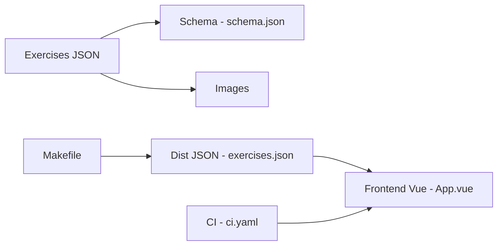

# yuhonas/free-exercise-db

> Open weight-training exercise database in JSON with images, and a Vue search interface.

## The problem
Free exercise lists are poorly structured, with no schema and no interface to browse them.

## What it actually does
Each exercise is a JSON document conforming to `schema.json` (id, name, force, level, mechanic, equipment, primary and secondary muscles, instructions, category, images). A Makefile validates the schema, produces `dist/exercises.json` and an NDJSON importable into PostgreSQL (`jq` required). Images are accessible via GitHub raw. A Vue/Vite site serves as a data browser.

## How it is wired


## Trying it
```bash
make lint
make dist/exercises.json
make dist/exercises.nd.json
npm install
npm run dev
```

## Cost and gotchas
Free. The `force`, `mechanic` and `equipment` fields are incomplete in some files (nulls allowed) and a few images are duplicated (25 files). Unlicense (public domain); the origin of the images is not specified.

## What it is not
Not a workout tracking app nor an API: a static dataset. No medical validation of the instructions.

## Alternatives
exercises.json, the original source cited in the README.

## For you
Watch: a ready-to-load dataset for a demo or a workout recommendation model; check the origin of the images before commercial use.
