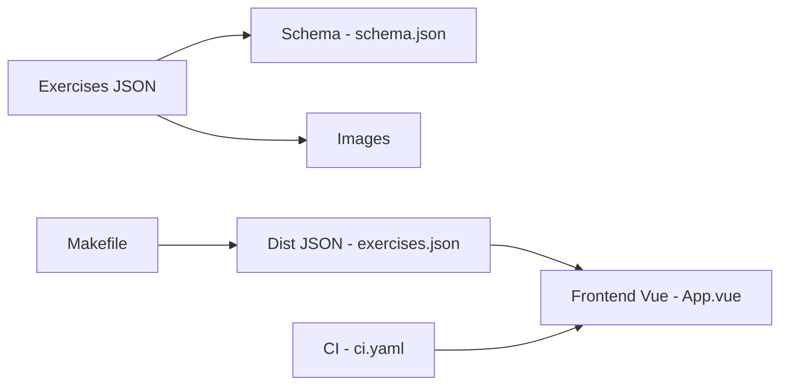

# yuhonas/free-exercise-db

> Base libre d'exercices de musculation en JSON avec images, et interface de recherche en Vue.

## Le problème
Les listes d'exercices libres sont mal structurées, sans schéma ni interface pour les parcourir.

## Ce que ça fait vraiment
Chaque exercice est un document JSON conforme à `schema.json` (id, nom, force, niveau, mécanique, équipement, muscles principaux et secondaires, instructions, catégorie, images). Un Makefile valide le schéma, produit `dist/exercises.json` et un NDJSON importable dans PostgreSQL (`jq` requis). Les images sont accessibles via GitHub raw. Un site Vue/Vite sert de navigateur de données.

## Comment c'est branché


## Essayer
```bash
make lint
make dist/exercises.json
make dist/exercises.nd.json
npm install
npm run dev
```

## Coût et pièges
Gratuit. Champs `force`, `mechanic` et `equipment` incomplets dans certains fichiers (nuls autorisés) et quelques images en double (25 fichiers). Licence Unlicense (domaine public) ; l'origine des images n'est pas précisée.

## Ce que ce n'est pas
Pas une application de suivi d'entraînement ni une API : un jeu de données statique. Pas de validation médicale des instructions.

## Alternatives
exercises.json, la source d'origine citée dans le README.

## Pour toi
Surveiller : jeu de données prêt à charger pour une démo ou un modèle de recommandation de séances ; vérifier l'origine des images avant usage commercial.

